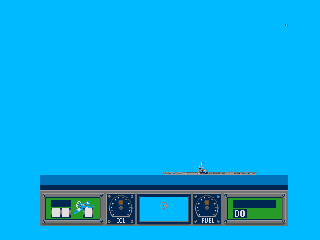
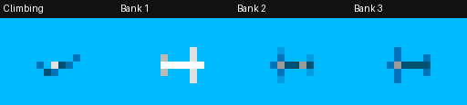
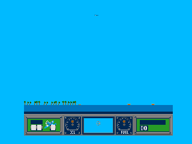
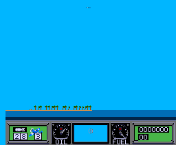

# Altitude and distant-view correction

The earlier prototype capped height at 255, so the distant aircraft only rose
32 screen pixels. It also used `plne`, a static map marker with a two-row shape,
rather than the original player-aircraft pose set. The distant sea rectangle
was missing, leaving cyan between the reduced hull/shore and dashboard.

The original player renderer uses a distant baseline of 1208 and a three-bit
projection shift (`wings` file 0x2a0 and 0x524). This gives a 151-pixel distant
baseline in its 162-line view. The MSX view retains its 161-pixel baseline and
now supports a 0–1200 height range, letting the aircraft reach the top portion
of the distant view. The 1200 ceiling is the prototype's chosen bound for this
projection span; original flight dynamics and their exact ceiling are not
claimed to be ported. Starting height remains 92. World Y is now unsigned
32-bit Q8 for this mission configuration, avoiding the former 16-bit limit.
Other prototypes retain their earlier vertical representation and bounds.

The source distant renderer fills a solid color-10 sea rectangle from row 151
to the bottom (file 0x3ea2). The MSX conversion fills rows 161–171 using the
corresponding mission ocean blue, preserving the original sand pixels at row
161. The carrier hull now meets the water surface.
This distant fill is deliberately flat; the close view keeps animated waves.

All 27 original `lpn…` records are retained with their own drawing origins and
heights. Original transparent pixels remain transparent, rather than becoming
green padding. The source reduced-pose table begins at file 0x13ed4; pitch and
bank selection code is at 0x490–0x516. The current normal-pose indices select
matching reduced pitch/bank art through an explicit adapter. This preserves
visible attitude changes while retaining the prototype's existing controls
and turn timing. It does not reproduce original flight dynamics.

The reduced frames are packed into three verified 48×24 atlas rectangles.
The manifest records every source hash, origin, atlas placement and normal-to-
reduced pose mapping. The emulator checks all 27 cached frames and captures
climbing plus three distant bank poses, alongside the full-height and reset
bounds. Host tests cover the expanded Q8 limits and NTSC/PAL simulation parity.

The workload currently needs eight VBlanks per presentation: 7.5 fps NTSC /
6.25 fps PAL, with 20/24 simulation steps maintaining nominal 150 Hz updates.
The former six-VBlank cadence missed an NTSC deadline at a shoreline crossing.
At PAL's 24 steps per presentation, the 12-step wave clock samples six of the
twelve phases; all twelve original frames remain loaded. View changes still
rebuild hidden pages and pause simulation. Faster rendering remains planned
work; the close-view pan is described below.

## Distant sand strip correction

The sea fill had overwritten the one-pixel sand strip already reconstructed
from the original reduced terrain. It now preserves source palette index 17
(MSX index 14) at viewport row 161; rows 162–171 remain ocean blue. The original
`8thscale.shp` beach records, `bchl` and `bchr`, supply the shoreline silhouettes.
Coarse ground outside their outer edges is removed so it cannot leave detached
sand fragments. The close-view artwork is unchanged.

The generated terrain uses 493 shared tiles. The release excludes the unused
legacy fixed-pose aircraft entry point to fit the resident ROM, now 32,728 of
32,768 bytes; debug profiles retain that entry point.

Validation: 117 host tests pass. Release gameplay checks pass 78 snapshots on
each NTSC and PAL profile. Renderer checks pass 59 NTSC and 65 PAL snapshots,
including full-VRAM comparison over the distant island. Results include ROM
hashes: [release NTSC](sand/release-ntsc.json), [release PAL](sand/release-pal.json),
[renderer NTSC](sand/renderer-ntsc.json), [renderer PAL](sand/renderer-pal.json).
The image below is a VRAM reconstruction, not a raster or hardware capture.

## Close-view pan

The original's render loop (CODE 0x26e) places the close view's baseline
at 151 + max(0, altitude − 131). Above altitude 131 the whole scene moves
down with the plane, which stays at its pinned row. The distant view takes
over above altitude 186 (0xc966 sets the view to 1 above 0xba). Between the
two, the ground slides out of the bottom of the view and back as the plane
climbs and descends. The port used to pin the plane without moving the
scene, so in that band the plane seemed not to descend and bombs appeared
above it.

The port now pans by p = altitude − 131 (0..55) in two parts.

- **Whole tile rows, in software (`g_PanRows` = 8 × (p / 8)).** Every
  scenery layer is drawn that many rows lower. The terrain shifts each
  decoded column down by p / 8 sky tiles before the tile-cache diff, and
  the column cache key carries the shift in its top 3 bits. The other
  layers add `g_PanRows` to their rows: the ship, signalmen, elevator
  and well edge (clipped at row 172), bombs and smoke. Overlay rows
  marked for repaint move with it too. Waves are skipped once the strip
  (rows 161..171) is a tile row or more below the view. A change of p / 8
  rebuilds that page like a view change, at most 7 times across the band.
- **The last 0..7 px, in hardware (`s_RenderFine`).** R23 already scrolls
  the scene by the carrier's heave. Wrapped top rows would show VRAM rows
  248..255, which hold cached wave frames, so the top lines keep the
  heave-only offset (they show sky). A line interrupt at line s = heave +
  fine (R19 = fine, counted in the top offset) switches to the full offset
  (`pan_split$` in `VDP_HBlankHandler`). The plane, drawn at its screen
  row, subtracts the full scroll.

The bottom split no longer relies on a dark guard line drawn into the play
area. That line moved with the scroll and left stale rows when the scroll
shrank, and repainting them cost about 40 ms a frame. Instead, the first
dashboard interrupt sets R23 = +2: the last play lines then show the
dashboard's top rows, VRAM 172..175, which are solid colour 1. The second
interrupt, at line 172, restores R23 = 0 and finishes the palette. The
split is two-stage in every view now.

Verification: `tools/p0_smoke.tcl` climbs into the distant view after the
island run. It comes down through the band over the carrier with a bomb
falling, and captures `pan_high` (pan 45..55) and `pan_mid` (17..29). The
cannon tests also fly in the band (pans 7..38). `verify_world_flight.pan_of`,
`vram_row` and `split_line` model the pan, the two scroll regions and the
split in the oracle. NTSC and PAL run with no missed frame deadline.
