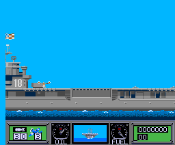
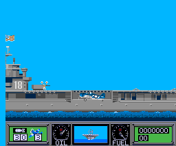
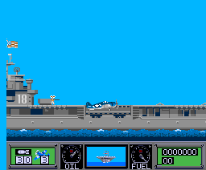
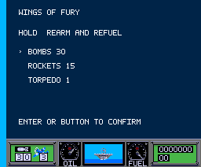

# Carrier elevator and service

The later [deck personnel correction](deck-personnel.md) adds the original
arms-down waiting pose during platform travel and a one-arm pointing cycle.
Its report contains the current crew asset and validation details.

The release practice sortie now starts inside the carrier and emerges on the
original elevator, initially facing left. Taxi onto the platform, stop and press
either logical Fire button to lower it again: Space/joystick trigger 1, or
N/GRAPH/joystick trigger 2. Enter remains a menu confirmation key. Outside the
platform, or while moving/turning, the ordinary weapon controls remain active.

At the bottom, the hold opens the existing loadout menu and replenishes the
sortie's stock, oil and fuel state. Confirming raises the platform again without
resetting world position, heading, rank, score, lives or mission progress. A
right-facing plane returns facing right. Bomb rearming is playable; rockets and
torpedoes retain their existing unavailable previews until their weapon stages.
The oil/fuel gauges remain the existing static artwork; no new functional gauge
claim is made here.

Fire is routed before weapons while boarding. Held buttons are consumed at
context and elevator boundaries, so a held confirmation cannot fire guns or
immediately lower the platform after emergence. Esc pauses the elevator and its
clocks along with the rest of gameplay. Ctrl-R still starts a new game.

## Original artwork and geometry

`world.shp:elev` is the recovered 64x13 platform with drawing origin (28,-1).
Its raw record SHA-256 is
`14f50af2c0b08c19ffab426e6ba646f94c9f037da4e8ad45cb2a5e0b40223e25`.
The executable selects elevator shape slot 37 near file offset 0x40e4. The map
contains its special, non-static marker at X=7000. The existing reset X=7032,
the decoded shaft and the supplied reference captures support the platform
anchor used here: X=7032, drawing left X=7004 after subtracting the source origin.
The first/last opaque platform columns are X=7010/7064, inside the drawn shaft.
This alignment is based on those combined observations, not on the reset X alone.

The shaft, stairs and foreground are decoded `mcar` artwork. At full height the
platform top is viewport row 129 and the tires sit immediately above it. As the
platform lowers, the plane moves with it. Clipping at the shaft's lower lip,
row 145, hides the plane and platform behind the hull instead of drawing them
through the ship's side. A depth of 32 pixels hides the plane completely.
Carrier heave moves all these parts together.

Boarding currently requires ground mode, no turn, zero horizontal velocity and
a position within six pixels of X=7032. There is no teleport from elsewhere on
the deck. Actual landing/hook capture, enemy interference and carrier damage
remain separate P2/P5 work.

## Animation and storage budgets

The portable three-byte carrier state has raising, deck, lowering and hold
stages. It moves one pixel per 18 ticks of the nominal 150 Hz simulation clock:
576 ticks, or 3.84 seconds, for a full trip. Heading stays in flight state and
is never reset by service. Travel depth, boarding tolerance and timing are MSX
tuning parameters, not recovered original numeric rules.

Moving elevators publish every six VBlanks: nominally 10 fps NTSC / 8.33 fps PAL.
This keeps each displayed change to one or occasionally repeated pixels. Ordinary
flight and taxi retain eight-VBlank presentation. Measurements show median lift
publication intervals of 100.13 ms NTSC and 119.62 ms PAL, with maximum regular
lift redraws of 61.14 / 60.89 ms and zero missed regular frame deadlines.

The clean 64x40 shaft backdrop and four 32x7 platform pieces use free VRAM in
page 1 at X=144..239, Y=468..507. That region is beside the cached final wave
frames and the aircraft backup, above the sky-only wrap rows. Disjointness tests
cover all wave bytes, aircraft backups, ground-turn cache, terrain, crew and
other atlas allocations. Original platform transparency is retained.

`tools/convert_elevator.py` writes a 1,728-byte immutable bank-15 bundle and a
source-hashed manifest. The four original flag/radar frames moved from a
2,176-byte resident RLE stream to uncompressed data after the crew in bank 13;
that bundle now occupies 5,306 bytes after the personnel correction. All original flag/radar pixels are retained.
Ordinary empty weapon updates now skip unnecessary flight-sample preparation
while preserving the 25 Hz clock; differential tests cover every weapon state
and stock change against the unoptimized simulation.

The release occupies 32,749 of 32,768 resident bytes (19 free). Static data and
initializers occupy 9,671 bytes before IM2, stack and BIOS workspace. The debug
profile remains an airborne renderer harness and does not run the elevator.
Further resident gameplay will require more code/data banking or optimization.

## Validation

All 116 host tests pass. Both NTSC and PAL release runs pass 78 published
snapshots, including initial emergence, original platform pixels and hull
occlusion at several depths, actual bomb expenditure and reload, service with
both headings, held confirmation, pause/resume during descent, all ground-turn
poses, end stops and the existing combat/input/HUD checks. Full gameplay pixel
comparisons, hidden-page immutability and mapper restoration also pass.

The separate debug renderer passes 58 NTSC / 65 PAL snapshots, with maximum
regular redraws of 88.48 / 94.36 ms and zero misses. The UI state snapshot is
prepared before the publication window and copied with the completed page,
keeping the publication marker within VBlank on both profiles.

Reports: [NTSC renderer](elevator/ntsc-renderer.json),
[PAL renderer](elevator/pal-renderer.json), [NTSC release](elevator/ntsc-release.json),
[PAL release](elevator/pal-release.json). Images below are inspected VRAM
reconstructions, not raster screenshots or physical-hardware validation.

```sh
python3 -m unittest discover -s tests
python3 tools/convert_elevator.py --check
./build.sh projname=mission-flight
python3 tools/verify_p0.py --headless --output tools/.build/elevator-ntsc
python3 tools/verify_p0.py --headless --machine C-BIOS_MSX2+_EU --output tools/.build/elevator-pal
./launch.sh mission-flight
```





