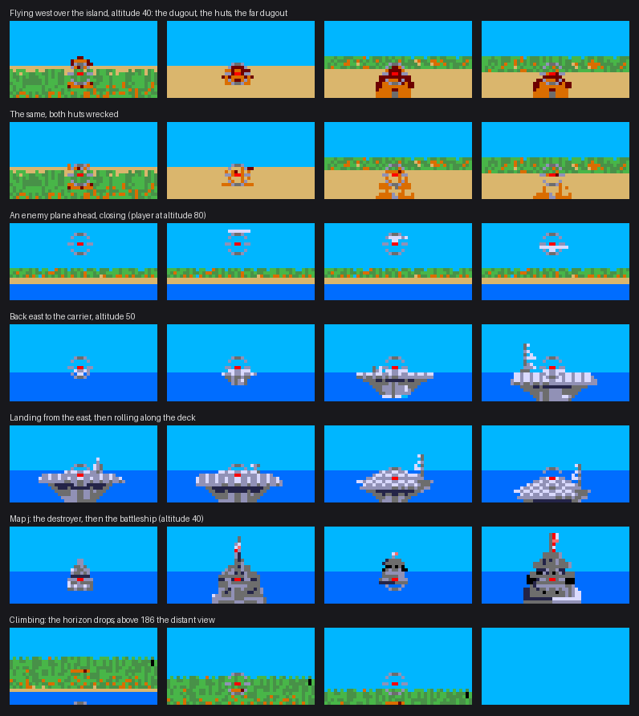

# The cockpit window

Started 2026-11-19, after play-testing: the pilot's window in the middle of
the dashboard showed fixed pictures (sea, island, carrier by altitude),
where the original shows what is ahead: the island's targets coming
closer, the carrier growing on the approach, the deck sliding past on
landing. How the original draws it is in
[research/amiga-cockpit-view.md](research/amiga-cockpit-view.md); this is
the port's version.

## How the original does it

Not a 3-D projection. The ground ahead is cut into 11 depth bands (13..190
map columns ahead, a column being 8 px), drawn far to near, each one row
lower than the last. Each band draws a pre-drawn shape sized for that band
(`dash.shp`), at the window's centre column: a 1-px tan line where the band
holds island ground, a jungle strip where it holds trees, and one object
(hut or wrecked hut, dugout, AA gun, carrier or its tower). The horizon
sits at row `altitude / 16` (climbing lowers it). Over the carrier, the
bands leave it out and a deck view is drawn instead: the deck, the carrier
and its tower, a row lower for every 6 columns of deck behind the plane,
so the deck is at its fullest at the stern (touchdown) and slides out of
the window as the plane rolls on. The gunsight goes last, its row following
the altitude below 81. Above altitude 186 (the distant view) the window is
plain sky.

## The port

- **Art** (`tools/convert_cockpit.py`): the shapes used, decoded with
  their plane constants, scaled 3/8 across (the original's 122 hi-res
  columns to the port's 46) with rows kept, in the dashboard's colours.
  They fill 7 of the 24 pilot-window atlas slots in VRAM (loaded at boot
  from bank 52, `Cockpit_Load`); slot 0 is the compose buffer. Every shape
  is drawn about the centre column, so its columns are clipped to the window
  once, in the converter. The frame sets are the ones the original
  evidently meant: its arithmetic is off by one or two for the jungle, for
  the carrier facing left and for the tower (the research's anomalies).
- **The map's features** (`--map`, `src/generated/map_<map>/cockpit_map.h`):
  spans in columns, from the original's map words: land, jungle (runs
  merged across gaps under 8 columns: no band is narrower, so a band
  touches a merged run exactly when it holds a jungle column), and objects
  sorted by column (huts in the island records' order, their wrecked state
  from `g_Island`; dugouts; AA guns; the carrier and its tower). The
  original's scan lets any other non-empty map word in a band hide its
  object; the port does not: each band shows its farthest object.
- **Two adaptations after play-testing** (2026-11-19, the user: arriving at
  the island, the first dugout showed, then only jungle): with the
  original's arithmetic, a nearer band's jungle strip (4..7 rows, full
  width, one row lower) covers the targets in the bands behind it, and at
  usual altitudes the near bands fall below the window (horizon at
  `altitude / 16 + 17`: at 40, only the bands 500 px and more ahead show),
  so a target was seen far off and then vanished instead of growing. The
  port draws the targets after all the ground, and its picture sits 5 rows
  higher (horizon at `altitude / 16 + 12`), so targets stay in view as they
  approach, and the carrier and deck show more on landing.
- **Scene** (`msx/cockpit.c`, segment 51): from the plane's column,
  altitude, facing, the torpedo plane's arrow and the huts, 19 bytes: the
  horizon, the deck step, the sight's row, the land and jungle bands, each
  band's shape. Two 191-byte tables give the bands a span of distances
  falls in (`Bands`, in Z80); only objects within reach are looked at (a
  window over the sorted list moves with the plane).
- **Composing**: when the scene changes, it is drawn into the buffer (VDP
  fills and transparent copies: the sky, sea and ground; then the targets,
  the deck view and the sight), then each page copies the buffer (one
  HMMM) the next time it is rendered, the arrow on top. The work (about
  30,000..45,000 T-states) is done in the idle time before a VBlank, like
  the terrain prefetch (`Cockpit_Work`); a render costs about 2,000. Without
  idle time for 12 renders (about 1.6 s; the heaviest stretches still
  have some), renders do it a step at a time: the scene, then the ground,
  then the rest; each picture then waits again. Stepping sooner cost the
  planes run 11 missed deadlines (17 with none, 19 with these 12). A page never copies a half-drawn buffer, and a change
  meanwhile waits for the picture under way, so a run of changes still
  shows.
- **Enemy planes** (flying or shot down, 48..1280 px ahead): in the band
  their distance falls in (the planes' own band edges, 0x4206), at the row
  the original gives, `band row - (altitude / 4 + 4)` from the original's
  horizon (not the port's raised one: a plane at the player's altitude
  sits near the gunsight, as there; one well above is out of the window),
  in the view its shape gives (`zr*`, the original's two name lists at
  DATA 0x3118 and 0x3188, swapped when the player faces right). Sizes: zr1
  for the nearest 3 bands, zr2 for the next 6, zr3 for the farthest 2. The
  original's offsets step half a set (0, 28, 56, 84) and so show some
  views from the other facing list; the port keeps the sizes and the right
  facing. They are drawn after the targets, the farthest size first. The
  render works out each plane's row and view (cheap; skipped when no plane
  slot is in use) and recomposes only when they change.
- **Enemy ships**: their views from their own archives (destroyer `db*`
  /`ds*`, battleship `bb*`/`bs*`, cruiser `cl*`/`cr*`, frames 1..8 of each
  facing, 0x45a6), in the band like the carrier, gone once sunk
  (`g_ShipsGone`). The kind comes from `mission_ships.h`. The tallest views
  (29 rows) keep their top 24 rows: with the raised horizon a near ship's
  top is always in the window. A carrier other than the player's (the
  Japanese one) uses the US carrier's views, as in the original; the deck
  view is only the player's carrier's. Over that carrier the bands leave
  out every ship, as the original does.
- **VRAM**: first-fit packing puts the 199 shapes in 19 of the 24 pilot
  slots; they load from banks 52 and 58 (14 slots a bank).
- AA guns are drawn intact (no map played so far has any).

## Verification

- `tests/test_cockpit_z80.py`: the compiled code on an emulated Z80
  against the converter's model (`scene`, `compose`), its VDP commands
  logged by a stub and replayed: 168 views on map a, 150 with planes, 88
  on map j with its ships whole or sunk, wrecked huts, no commands for an unchanged scene, the step-by-step
  fallback.
- `verify_p0`: the snapshots dump `g_Cockpit`; where the page shown holds
  the buffer's picture, the window is compared pixel for pixel with the
  model's (73 of 82 gameplay snapshots on NTSC).
