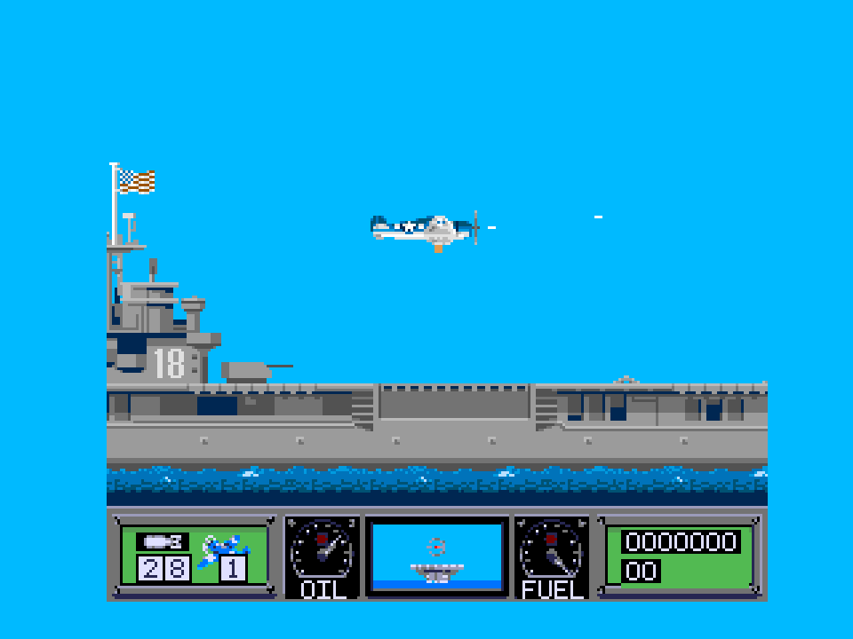
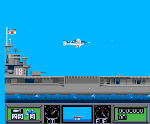
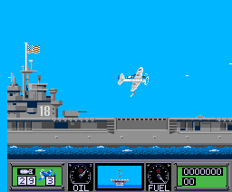
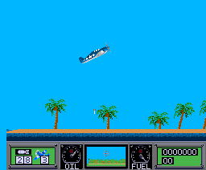
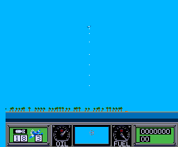
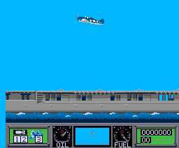
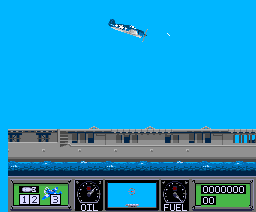

# B4: weapons foundation

The initial B4 gun/bomb and flat-surface impact simulation now uses the
[P0 controls and state](p0-foundation.md). The release starts with rank, briefing
and loadout shells; Space/trigger 1 fires guns and N/GRAPH/trigger 2 drops a
continuous bomb stream while held (about four per second). The selected-secondary HUD starts at 30 bombs, with
three lives. Guns are provisionally unlimited. Failed allocation does not spend
stock. Rocket/torpedo inventory previews show 15/1 but cannot launch a sortie.

Run `./launch.sh mission-flight` for the release flow or
`./launch.sh mission-flight-debug` for renderer inspection. The latter starts
in flight, uses R to reset/replenish at the current X and stationary T to turn.
Those shortcuts are absent from the release profile. Esc pause, Ctrl-R restart,
Ctrl-F joystick inversion and Enter/menu routing are described in the P0 report.
Enemies, destructible targets, damage and scoring remain later plan stages.

The portable core uses unsigned Q2 world positions and a 25 Hz weapon clock,
advanced by the existing 150 Hz flight clock. The inline clock avoids computing
and passing flight-position samples on intervening ticks. PAL/NTSC grouping is
deterministic. The minimum gun interval is 120 ms (pool saturation delays further shots),
round lifetime 480 ms and
impact lifetime 240 ms. Gun shots follow the aircraft pitch and heading, with inherited horizontal/vertical aircraft velocity;
bombs inherit it and accelerate downward. These are prototype parameters, not
recovered Amiga weapon physics or flight dynamics.

Training collision uses the decoded sea/island/carrier classes. The flat sea
and soil floor is height zero; the carrier deck is placed 32 pixels above it,
matching the current visual deck. This approximation does not cover raised
objects, ship sides, elevator motion, friendly damage or aircraft landing.
Impacts count for diagnostics only and do not award score or alter scenery.
Bombs now use the original artwork described below. Round and impact marks
remain small authored primitives; original explosion conversion remains future work.

Bitmap effects render after the aircraft on the hidden page. Each has a clipped,
byte-aligned footprint, backed up in an independent 8×8 atlas rectangle per
projectile and page. Restoration
unwinds effects in reverse draw order before restoring the aircraft. This
preserves overlapping effects, terrain, water and aircraft without trails.
World-ring seams split copies, primitives clip to the masked viewport, and
close/distant projection uses the same camera and vertical-offset conventions
as flight. Explicit initialization invalidates all clean-footprint caches at
startup. View rebuilds discard them instead of restoring obsolete scenery.

The shared allocator reserves these two rectangles after all pilot, aircraft,
terrain, wave and ship rectangles. The layout test checks their disjointness.
Ammunition updates touch only changed digits on the hidden dashboard, using the
same generated 5×7 face as its static artwork.

Reproduce validation with:

```sh
python tools/convert_dashboard.py --check
python tools/convert_ship.py --check
python -m unittest discover -s tests -v
./build.sh projname=mission-flight-debug
python tools/verify_world_flight.py --project mission-flight --debug-profile --weapons --output tools/.build/combat-ntsc
python tools/verify_world_flight.py --project mission-flight --debug-profile --weapons --machine C-BIOS_MSX2+_EU --output tools/.build/combat-pal
```

The weapon harness captures gunfire, bombs and impacts, checks complete visible
VRAM/raster output, live ammo, reset, both scales, both pages and hidden-page
immutability. It explicitly powers the test machine on so an emulator power
setting cannot stall the run. The host suite includes pool bounds, cadence,
stock exhaustion, held release and buffered short presses, signed/world bounds, inherited velocity,
sea/soil/deck impacts, reset and PAL/NTSC grouping.



Historical B4 validation (before P0; retained evidence): all 83 host tests passed. Graphics-enabled full-frame checks pass on
[Panasonic NTSC](combat/panasonic.json) (58 snapshots, maximum redraw 86.78 ms)
and [C-BIOS PAL](combat/pal.json) (65 snapshots, maximum redraw 89.63 ms), with
zero regular frame misses at the existing 7.5/6.25 fps. Both runs exercise
close/distant gunfire and bombs, deck impacts, six NTSC/eight PAL fired rounds,
two impacts, replenishment and both display pages. Reports retain the final ROM hash.
Resident code/data occupy 31,529 bytes of the 32 KiB resident window; roughly
1.2 KiB remains there. Larger combat additions will require more optimization
or a banked-code/data arrangement. Static data occupy 9,306 bytes before the
IM2 reservation, stack and BIOS workspace. Physical hardware remains untested.

## Original falling-bomb artwork

The close view uses `torpedo.shp` records `bom3` → `bom5` → `bom6` for
leftward releases, and `bom9` → `bom7` → `bom6` for rightward releases.
These preserve the source pixels, transparency and drawing pivots, padded into
five 8×8 VRAM frames. The source archive hash and atlas locations are recorded
in `assets_src/dashboard/manifest.json`.

A bomb starts horizontal for five weapon ticks (200 ms), rotates diagonally
for three ticks (120 ms), then points vertically down until impact. Direction
follows its inherited horizontal velocity. This timing is an MSX adaptation
of the supplied reference; the original physics and timing are not claimed to
be recovered. Existing inherited velocity, gravity, ammunition, impact and
far-view point rendering remain unchanged.

Clipped transparent VDP copies draw the cached sprites. Per-projectile backups preserve all opaque pixels and byte alignment.
Ammo and lives digit data move to dashboard bank 12, read only when changed,
leaving room for the sprite renderer in resident ROM.

Validation: 118 host tests pass, including original bomb pixels/pivots and
cache disjointness. Release checks pass 78 snapshots each on NTSC and PAL.
Weapon renderer checks pass 62 NTSC and 68 PAL snapshots, covering all three
orientations, full visible VRAM comparison, immutable bomb caches, overlap,
clipping and background restoration. ROM hashes are saved with the results:
[release NTSC](bombs/release-ntsc.json), [release PAL](bombs/release-pal.json),
[renderer NTSC](bombs/renderer-ntsc.json), [renderer PAL](bombs/renderer-pal.json).
The captures below reconstruct VRAM; they are not raster or hardware captures.





## Continuous bomb release

Holding N, GRAPH or joystick trigger 2 now releases bombs repeatedly. A separate
secondary cooldown uses 6/6/6/7 weapon ticks per four releases: 240/240/240/280 ms,
which averages four bombs per second on the 25 Hz weapon clock. This implements
the user's observed rate; an exact original executable timer was not confirmed.
The cooldown also applies to tapping. Brief presses between foreground samples
remain buffered, and overlapping keyboard/joystick aliases form one held input.
Releasing stops further drops. Pause freezes both cooldown and projectiles.

Two slots remain dedicated to gun rounds; sixteen additional slots allow bombs
to fall simultaneously for their full 100-tick lifetime. Failed allocation or
empty inventory spends no stock. Simulation and drawing scan only through the
highest occupied slot. Each projectile has its own disjoint 8×8 background
backup on each page; the bomb footprint includes only its opaque source bounds
plus byte alignment. The source bomb sprites and three rotation stages remain.

While bombs, their release cooldown or their previous page footprints are active,
presentation reserves two additional VBlanks. Flight and weapon simulation steps
increase proportionally, retaining 150 Hz simulation and the release rate.
The flight profiles use 10 rather than 8 VBlanks during that bomb workload
(the elevator separately uses a six-VBlank cadence). The baseline simulation step count is restored when the
extra workload ends. Unused legacy flight/weapon convenience wrappers are
excluded from the release build. Resident ROM is 32,727/32,768 bytes.

Validation: 119 host tests pass, including release intervals, concurrent bombs,
stock exhaustion, full-pool rejection, buffered taps and PAL/NTSC determinism.
Release control checks pass 78 snapshots on each video profile, including held
N/GRAPH overlap, held joystick trigger 2, pause, HUD stock and carrier reloading.
Weapon renderer checks pass 64 NTSC and 66 PAL snapshots, including eight bombs
in flight together, full visible pixels, source caches and hidden-page drawing.
[Release NTSC](bombs/repeat/release-ntsc.json),
[release PAL](bombs/repeat/release-pal.json),
[renderer NTSC](bombs/repeat/renderer-ntsc.json),
[renderer PAL](bombs/repeat/renderer-pal.json).



## Cannon pitch and heading correction

Cannon rounds now launch along the aircraft's nose rather than receiving a
fixed horizontal shot velocity. `Aircraft_FlightPitch` supplies the same pitch
convention to flight presentation and gun aiming. This distinguishes the
nose-up stall from its downward motion: its shots rise even while the aircraft
sinks. The latched dive fires downward, and level flight fires horizontally.
Both headings use mirrored horizontal components; banked turns retain the
flight core's committed heading until the reversal completes.

Ten authored shot vectors cover the original ten pitch poses. The muzzle moves
with that angle, then the round inherits the aircraft velocity. Existing rounds
retain their launch velocity as the plane changes attitude. Top/world-edge
checks prevent wrapped muzzle coordinates. The former padding byte in combat
state now holds the sampled aim pitch, preserving the 158-byte capture layout.
The vectors and muzzle distances are MSX tuning, not recovered original values.

Close-view tracers also follow the shot direction. The normal angled case uses
one native VDP line command; clipped or world-ring edge fragments use individually
clipped pixels. The per-page backup includes their three-pixel vertical extent,
so overlap, clipping and restoration leave no trails. Far-view rounds keep the
existing single-pixel representation.

The generated atlas tables and all 62 aircraft shape records now reside in raw
ROM bank 7 and load into RAM before aircraft caches are initialized. This frees
resident code space without changing sprite pixels or mapper restoration.
The bank contains 1,134 bytes: 576 bytes of padded atlas tables followed by
558 bytes of nine-byte Z80 aircraft records. Host tests verify every shape's
pointer offset, geometry and atlas coordinates against the source manifest.
The release occupies 32,473/32,768 resident bytes; SDCC static data plus
initializers occupy 11,071 bytes before stack, IM2 and BIOS workspace.

Firing reserves four additional VBlanks for cannon simulation, tracers and scene
redraw; bomb workload independently reserves two. Both flight profiles normally
present every eight VBlanks, use twelve while firing guns, ten for bombs, and
fourteen when both workloads are active. Thus gun rendering runs at 5 fps NTSC /
4.17 fps PAL; simulation remains 150 Hz, so flight speed and weapon release rates
are retained. The six-VBlank elevator cadence is unchanged. Faster rendering
remains separate optimization work.

Validation: all 124 host tests pass, including ten pitch vectors and muzzle
positions in both headings, top clipping, upward stall shots despite descent,
and downward dive shots. Release checks pass 89 snapshots each on NTSC/PAL,
including live cannon fire during stall, level flight and dive in both headings.
Full visible pixel comparisons cover the rotated tracers and original aircraft
poses. Renderer regressions pass 64 NTSC / 71 PAL snapshots, including concurrent
guns/bombs, cache integrity, mapper restoration and hidden-page immutability.
No regular frame deadlines are missed in these scenarios.
[Release NTSC](cannon/release-ntsc.json), [release PAL](cannon/release-pal.json),
[renderer NTSC](cannon/renderer-ntsc.json), [renderer PAL](cannon/renderer-pal.json).
The images below reconstruct VRAM; they are not raster or hardware captures.



