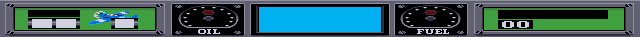
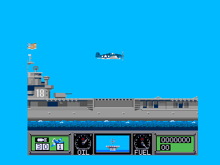
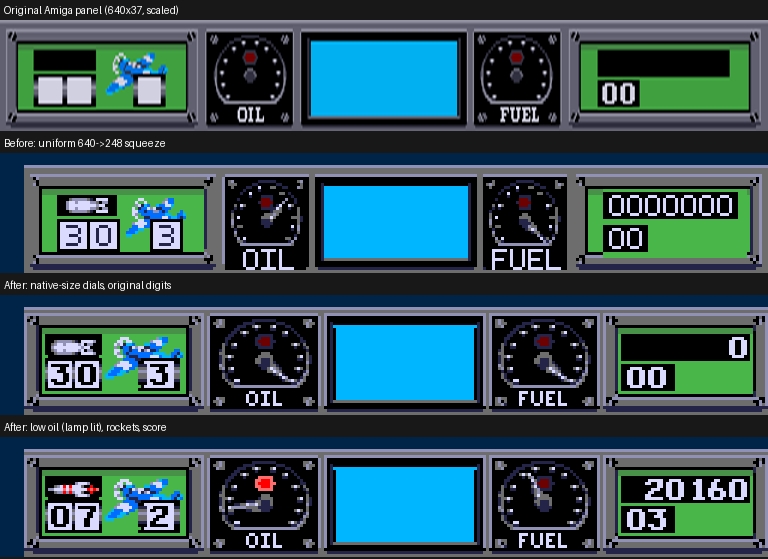
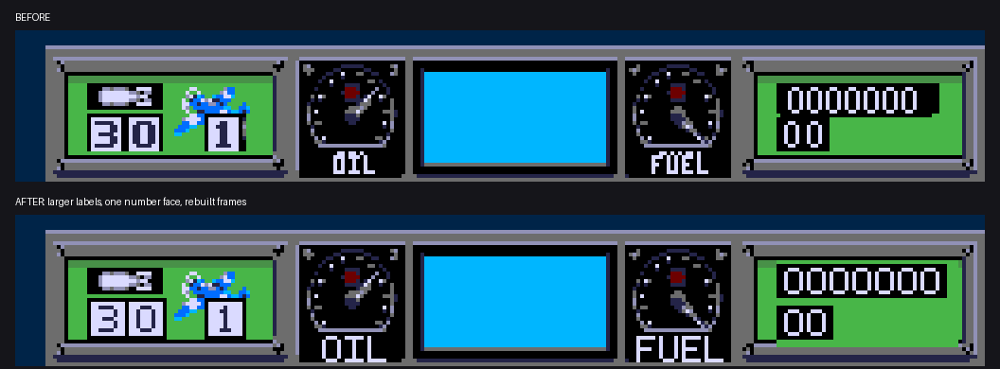
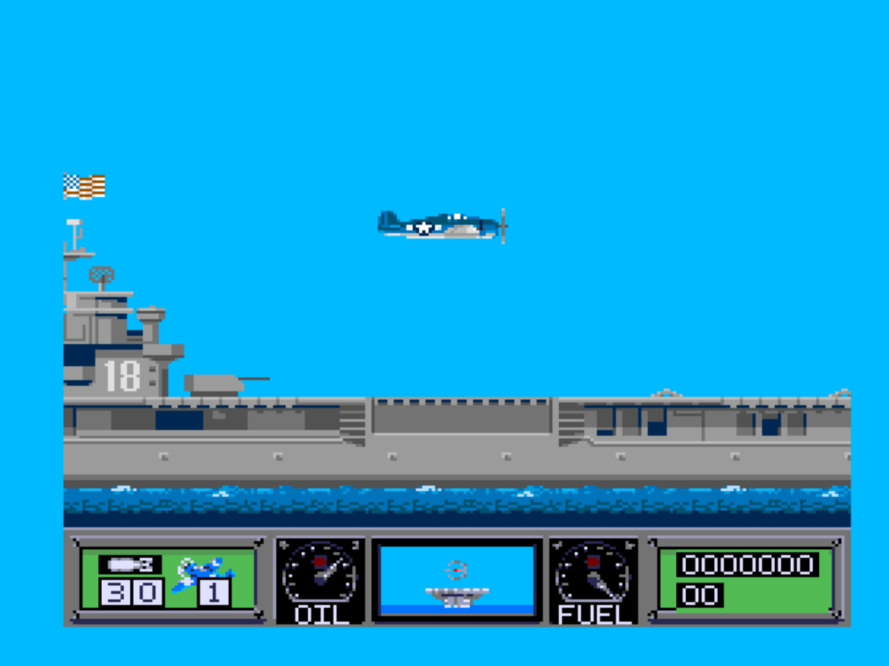

# Original dashboard and pilot display

Mission-flight uses the supplied Amiga dashboard artwork, adapted from 640×37
to 248×36 pixels after the MSX's eight-pixel mask. A four-line separator gives
the line ISR time to stop horizontal scrolling before the dashboard begins.
VBlank restores the flight-view offsets.





The central window is a forward-looking pilot display, not a miniature
side-view map. It now uses original `3dl`/`3dc` perspective sprites, altitude
profiles, forward surface queries and a fixed `targ` reticle. The earlier 2D
overview has been replaced. The original continuous projection and dynamic
entities remain future work; the current profiles are an MSX adaptation.

## Recomposed panel (2026-11-14)



The previous pass squeezed the 640-pixel hi-res panel uniformly into 248
pixels with nearest-neighbour sampling. Dials ended up 26–28 pixels wide
instead of their native 37, the dot ring and needles broke up, and the
counters and OIL/FUEL legends used a home-made 5×7 face. Now:

- **Exact 2:1 reduction.** 640 hi-res pixels become 320. Where a pixel pair
  differs, the locally rarer colour is kept, so 1-pixel detail survives.
- **Column cuts, not scaling.** The remaining 72 columns are removed only
  where a column equals its neighbour: flat frame, green fill, box and window
  interiors (`PANEL_REMOVE`; the converter checks each one). Row 2, a
  duplicate of row 1, is dropped to fit 36 rows. The dials keep their native
  size.
- **Original needles and lamp.** The 23 `ndl1`..`ndln` frames sweep from
  empty (lower left) to full (lower right). They are composed onto the dial
  in hi-res and then reduced. The `olof` lamp lights bright red when a gauge
  is critical (manual: "a red light blinks").
- **Original digits.** `wnum` is drawn on a double-pixel grid (12×7 hi-res,
  4-pixel strokes), so the 2:1 reduction gives lossless 6×7 digits with
  2-pixel strokes. Ammo and lives are black on white, score and kills white
  on black.
- **Legends.** OIL/FUEL use a 1-pixel-stroke face matching the original
  2-pixel hi-res strokes, because the reduced lettering breaks up.
- **Weapon icons.** The original `bomb`/`misl`/`torp` icons lose their own
  green background and uniform body columns to fit the box.
- **Score.** Six digits, right-aligned with blank leading zeros, as in the
  manual's "20160". Seven no longer fit beside native-size dials.
- **Pilot window.** 46 pixels wide (the frames render 46 wide in 48-pixel
  atlas slots) at an even x, as HMMM requires.

Every dynamic element is a byte-aligned rectangle with one pre-rendered copy
per value, in banks 17 (ammo, lives, weapon, lamps, oil dial) and 18 (fuel
dial). `Dashboard_Status` and `Dashboard_Gauges` copy a rectangle only when
its value changes. A lamp lies inside its dial and is redrawn after it. It
only switches at or below `LAMP_CRITICAL_FRAME`, where no needle reaches it;
the converter checks this. The score and kills digits sit on a 7-pixel pitch,
so neighbours share bytes. They will be plotted at runtime from the generated
glyph rows when scoring arrives (P3); until then the panel shows 0 and 00.

`convert_dashboard.layout()` is the single source of positions for the
converter, the generated header (`HUD_*`) and both pixel oracles. The oracles
compose the expected dashboard from the same game state with `compose()`.

The panel and pilot window use the original dashboard palette, quantized from
Amiga RGB4 to MSX RGB3. The line interrupt switches it during the four separator
rows; VBlank restores the flight palette. Carrier heave still resets scrolling
earlier: that interrupt stages colors unused by the ocean, and a second line
interrupt finishes the lower entries before the icons and pilot window begin. Index zero retains the
flight border sky. Slot 1 retains the same dark sea color in both palettes,
so the four separator rows stay constant throughout each transfer; dashboard
blue moves to unused slot 9. Opaque black uses index 11. The previous separator
used slot 11 before it had changed from flight white to dashboard black, which
caused the bright flickering stripe. All separator rows are now raster-checked.
This restores black dial
faces, the red warnings, green panels and the distinct gray frame shades.
Palette writes are unrolled, and terrain column traversal uses sequential
pointers to preserve the existing presentation budget.



The launcher loads `tools/pixel_display.tcl` for crisp scaling (`simple`, no
blur or scanlines) without saving over personal emulator preferences. The
previous personal `hq` filter rounded tiny stems into distorted lettering.
Checks capture both raw pixels and normal display screenshots.



The 248-pixel display width still requires horizontal compression, and MSX RGB3
cannot reproduce every original RGB4 shade. The pilot display remains the
altitude-profile adaptation described above.

The [source manifest](../assets_src/dashboard/manifest.json) retains hashes,
dimensions and origins for all 223 `dash.shp` records, as well as the packed
pilot atlas locations and 27 reduced aircraft records. Pilot frames load once into
unused atlas rectangles and are copied onto the hidden display page when the
profile changes. The atlas allocator and full-frame verification check that
these rectangles do not overlap aircraft or terrain.

See [the scenery fidelity pass](scenery-fidelity.md) for close/distant views,
waves, source evidence, memory layout, timing and remaining limitations.

```sh
python tools/convert_hellcat.py
python tools/decode_mission.py
python tools/convert_mission.py
python tools/convert_dashboard.py
./build.sh projname=mission-flight
```

Each converter supports `--check` to verify generated artifacts. Earlier
static-dashboard and side-overview reports are retained under `docs/mission/`
as historical milestones, with their original ROM hashes.

The fidelity build passes all 75 host tests and full visible-pixel, palette,
scrolling, hidden-page and timing checks in both
[Panasonic NTSC](mission/panasonic-dashboard-fidelity.json) (54 snapshots,
7.5 fps, maximum redraw 79.17 ms) and
[C-BIOS PAL](mission/pal-dashboard-fidelity.json) (62 snapshots,
6.25 fps, maximum redraw 88.23 ms), with no missed deadlines. These reports
record the exact ROM hash. Reproduce the emulator checks with:

```sh
python tools/verify_world_flight.py --project mission-flight --debug-profile --output tools/.build/dashboard-fidelity
python tools/verify_world_flight.py --project mission-flight --debug-profile --machine C-BIOS_MSX2+_EU --output tools/.build/dashboard-fidelity-pal
```
