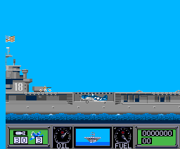
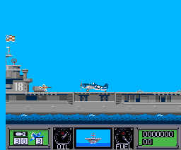
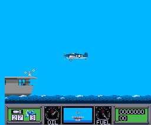

# Deck personnel signals

The elevator signalman now stands with both arms down while the platform is
raising, lowering or inside the hold. When it reaches the deck, he holds his
left arm horizontal toward takeoff and waves only his right arm. The man at the
right end of the deck always uses that pointing movement, independently of the
platform state. Both continue to follow carrier heave.

The original `world.shp` records already contain separate left- and right-arm
artwork. Pointing combines fixed `fgy1` with the eight right-arm poses
`fgy8`..`fgyf`. The quiet pose combines `fgy0` with `fgy8`, matching the supplied
arms-down capture. No new figure artwork was invented. The source record hashes
and drawing origins remain in the conversion manifest.

`tools/convert_ship.py` now produces eight pointing composites for each of the
two map positions and one additional quiet composite for the elevator man.
The seventeen poses use 34 disjoint 22x7 VRAM pieces. The complete clean backdrop
is retained in each pose so changing signals removes the old flags without
trails. The original four flag/radar frames follow these crew pixels in ROM
bank 13: their offset is now 2,618, and the full bundle occupies 5,306 bytes.
The existing right-arm cycle advances every 15 simulation ticks; exact original
animation timing remains unverified.

All 117 host tests pass, including source-pixel checks for the fixed arm,
right-arm cycle, quiet pose and cache disjointness. Release checks pass 78 full
pixel snapshots on each of NTSC and PAL. They include both lift directions,
completion at deck height, service visits and views of the end signalman.
These are inspected VRAM reconstructions, not fresh raster screenshots or
physical-hardware validation.

The debug renderer regressions also pass: 58 NTSC / 65 PAL snapshots.

Reports: [NTSC renderer](personnel/ntsc-renderer.json),
[PAL renderer](personnel/pal-renderer.json), [NTSC](personnel/ntsc-release.json), [PAL](personnel/pal-release.json).

```sh
python3 tools/convert_ship.py --check
./launch.sh mission-flight
```




