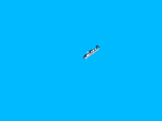

# First controllable flight increment

This records the first movement milestone. The current ROM adds recovered
orientation frames, applied drawing origins and banked turns; see
[aircraft orientation](aircraft-orientation.md). Earlier measurements below
are retained as historical evidence for their recorded ROM hash.

Implemented and validated 2026-11-10. The ROM now supports directional,
inertial movement over a static sky using three aircraft poses. This is an
arcade movement baseline, not a reconstruction of the Amiga game's flight
physics. Lift, gravity, stalls, takeoff and landing remain future work.

## Run and controls

```sh
./build.sh
openmsx -machine Panasonic_FS-A1WX-512K -cart out/wings.rom
```

- Cursor keys or joystick port 1: accelerate in a direction. Opposing inputs
  cancel their acceleration; each released axis slows toward rest.
- Space or joystick port 1 fire: reset to `(104,88)`, with zero velocity,
  level pose and right-facing artwork. Holding reset keeps it centered.
- While resting, 1/2/3: retain manual climb/level/dive graphics selection.
  Directional input cancels the manual override.

The plane clamps to the screen, with its complete 48×32 canvas inside the
256×212 display. Hit Space/fire if you want to return to the center. There
is no scrolling, scenery, combat, sound or HUD in this increment. Joystick
support uses the BIOS's port-1 direction/trigger reads; the automated emulator
runs exercise the cursor-key and Space paths. A physical joystick and the
real Panasonic still need hands-on validation.



## Simulation

`src/core/flight.c` and `.h` use standard fixed-width C integers and no MSX
headers, video routines, OS calls or floating point. Positions use unsigned
Q8 pixels; signed Q8 velocities express movement per simulation tick.

The core advances at 150 ticks per nominal second. Each two-VBlank display
interval runs five ticks on NTSC or six on PAL, giving equivalent simulation
time for 30/25 presentation intervals. Real machine refresh rates are close
to, rather than exactly, 60/50 Hz, so wall-clock motion follows those small
hardware timing differences.

Held input adds 5 Q8 velocity units per tick, with per-axis caps of about
120 px/s horizontally and 90 px/s vertically. Release/opposed input removes
3 units per tick, providing a short coast. Screen-bound handling clamps the
position and stops outward velocity without unsigned wraparound. Pose follows
vertical velocity; facing follows horizontal velocity and persists at rest.
Diagonal motion uses independent axis limits, not a constant-length speed.

Host tests compile this same source with the host C compiler and test reset,
rest, acceleration, coasting, braking before reversal, opposed controls,
long held-input boundary cases, and equivalent PAL/NTSC tick grouping.
These checks run with the normal Python unittest suite and require `cc`.

## Drawing and timing

The three existing packed frames are still the right-facing source artwork.
The converter now also emits three exact pixel reflections for left-facing
movement. These are temporary derived views, not validated original turning
frames. The source manifests record the transformation and output hashes.
Original pivots/hotspots remain unapplied; all poses retain their centered,
padded 48×32 canvases. The next animation increment should map authentic
orientation frames and visually normalize their pivots.

Rendering remains double-buffered across two 32 KiB VRAM pages. Each page
remembers its own previous aircraft rectangle. Before reusing that hidden
page, a VDP HMMV command clears the old rectangle; the code waits for the
command to finish and copies the new 768-byte frame row by row. The display
page changes only after the next scheduled VBlank. Resting scenes skip
unnecessary redraws. CPU transfers align X to a two-pixel byte boundary;
the simulation retains its finer Q8 position. This alignment is a known
visual limitation at very low horizontal speeds.

MSXgl's VBlank-only IM2 ISR now drives a private 8-bit tick counter, preserving
BIOS entry points for direct input calls. Tick differences handle counter
wraparound; the smoke runs span several wraps. MSXgl reserves `C000–C1C3` for
the ISR/vector table and places globals starting at `C1C4`. Default BIOS
background services do not drive the game loop. This avoids depending on
the BIOS clock for presentation deadlines. The clock owner and memory reserve
are configured in `project_config.js`; the copied engine remains unchanged.

## Measured acceptance

| Configuration | Publication samples | Median interval | Maximum redraw | Missed deadlines |
| --- | ---: | ---: | ---: | ---: |
| Panasonic_FS-A1WX-512K | 406 | 33.377 ms (30 fps target) | 13.68 ms | 0 |
| C-BIOS_MSX2+_EU | 340 | 39.873 ms (25 fps target) | 13.18 ms | 0 |

These are emulated-machine timings on the installed openMSX 21, not host
wall-clock performance. Redraw includes clearing the old rectangle and
transferring the new frame; it excludes simulation/input and the scheduler's
wait. Interval measurements include the entire game loop. No claim of a
worst-case budget for future scrolling/combat is implied.

The full ROM is padded to 32 KiB; occupied bytes currently total 7,942.
Static globals use 89 bytes, in addition to the 452-byte IM2 reservation,
stack and BIOS workspace. The two reserved VRAM pages still occupy 64 KiB.
Mirrored artwork adds 2,304 ROM bytes. No extracted audio is included in ROM.

Ten snapshots per configuration cover initial rest, climb/right motion,
coasting to rest, dive/left motion, reset, each of the four screen limits,
and final reset. The verifier compares the **entire displayed 32 KiB page**
against a sky-filled page containing the expected packed frame at the
published coordinates. This catches trails, incorrect mirroring, out-of-bounds
writes and leftover UI pixels. Palette/mode checks, display-page checks,
VBlank publication checks and timing checks also pass.

The separate idle 1/2/3 regression passes five additional snapshots,
including held-key behavior. All 36 host/parser/asset tests pass.

Retained evidence:

- [Panasonic report](flight/panasonic-verification.json)
- [PAL report](flight/pal-verification.json)
- [Manual-pose regression report](flight/frame-selection-verification.json)
- [Climb/right capture](flight/up-right.png)
- [Dive/left capture](flight/down-left.png)

Each report records the tested ROM SHA-256. No personal machine definition
or firmware is copied into the repository.

## Reproduce validation

With the existing Python environment containing `requirements.txt`:

```sh
python tools/convert_hellcat.py --check
python -m unittest discover -s tests -v
./build.sh
python tools/verify_flight.py
python tools/verify_flight.py --machine C-BIOS_MSX2+_EU --output tools/.build/flight-pal
python tools/verify_screen5.py --output tools/.build/flight-frame-selection
```

Emulator checks need graphics access, open their own window, isolate writes
under the output directory, and preserve read access to the user's reference
machine and firmware. Full captures, VRAM dumps and profiling output remain
under the ignored `tools/.build/` directories.

Next increment: replace the temporary three-pose/mirrored animation with
mapped original orientations and stable pivots, then develop the flight
response against observed game behavior. Scrolling should follow a separate
VRAM/VDP benchmark rather than being mixed into the first motion milestone.
