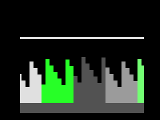

# V9958 horizontal-scroll and column-streaming benchmark

Completed 2026-11-11. This independent SCREEN 5 ROM streams a synthetic
4,096-pixel world through a 512-pixel VRAM ring. It demonstrates full-height
terrain scrolling at 30 Hz NTSC / 25 Hz PAL with offscreen column updates.
Aircraft composition and camera following are now measured in the separate
[world-flight prototype](world-flight.md). Original maps remain future work;
this standalone experiment is not completion of the combined B3 milestone.

## Run

```sh
./build.sh projname=hardware-scroll
openmsx -machine Panasonic_FS-A1WX-512K -cart out/hardware-scroll/hardware-scroll.rom
```

The landscape automatically scrolls at nominal 90 px/s. **P** pauses and
**R** reverses direction; both use key edges. The 150 Hz movement accumulator
advances three pixels per NTSC presentation and alternates three/four on PAL.
World coordinates wrap at 4,096 independently of the 512-pixel VRAM address.
The test artwork has distinct distant markers in each 512-pixel world region,
so repeating the initial ring cannot pass the world comparison.

The subproject uses its own source module, symbols, library and output
directory. `./build.sh` and `./launch.sh` still build/run the aircraft prototype.



## Memory and publication

Pages 0 and 1 form a live 512×212 bitmap, consuming 54,272 visible bytes
within their 64 KiB address reservation. They are not alternating frame buffers.
Pages 2 and 3 are cleared as a sentinel and never written during scrolling;
the aircraft atlas can retain its existing upper-VRAM allocation when integrated.
The experiment occupies 2,987 ROM bytes before padding to 32 KiB, and 74 static
RAM bytes plus MSXgl's 452-byte IM2 reservation, stack and BIOS workspace.

The renderer enables double-page scrolling through R#25 bit 0 and sets R#2
bit 5 (`VDP_SetPage(1)`). MSXgl's `VDP_SetHorizontalOffset` programs coarse
R#26 and fine R#27. R#25 bit 1 masks the left eight pixels, giving a visible
248×212 playfield inside the 256×212 active display. Offset registers are
updated together during VBlank, at the same two-interrupt cadence as flight.
See the [MSXgl VDP API](https://github.com/aoineko-fr/MSXgl/blob/main/engine/src/vdp.h)
and the vendored `MSXgl/engine/src/vdp.c` implementation.

Crossing an eight-pixel boundary prepares the new right column when moving
forward, or the new left column when reversing. Four HMMV commands draw sky,
terrain, ocean and a distant marker across its 212 rows. The column lies
entirely outside the currently published 256-pixel window; it is ready before
the new offset exposes it. The maximum camera step is four pixels, so only
one new column is needed per presentation. Larger jumps are unsupported.

Initial VRAM setup runs with display disabled. Normal terrain writes can run
during active display because their addresses are outside the current window.
There is no full-screen scenery copy per frame.

## Acceptance evidence

| Emulated machine | Publications | Median interval | Maximum column update | Misses | Pixel snapshots |
| --- | ---: | ---: | ---: | ---: | ---: |
| Panasonic_FS-A1WX-512K | 1,656 | 33.377 ms | 4.683 ms | 0 | 36 |
| C-BIOS_MSX2+_EU | 1,386 | 39.874 ms | 4.378 ms | 0 | 33 |

These are standard-speed emulated-machine timings. The update measurement
covers column planning and VDP command completion between `g_Rendering`
writes; publication cadence additionally covers input, movement and scheduling.
Frames without a new column take about 0.141 ms in the measured region.

Each run checks:

- Every visible VRAM pixel against a separate Python world model, plus the
  actual completed raster, including the eight-pixel mask and all fine phases.
- Forward page seams at 256, ring seams at 512, both directions of the 4,096
  world wrap, and page seams after reversal.
- The exact palette and scroll registers, P pause persistence and R reversal.
- All 575 incoming column addresses against the currently displayed window
  before drawing, and an unchanged upper 64 KiB at every snapshot.
- VBlank publication, zero natural deadline misses and stable 25/30 Hz cadence.

For raster captures the harness briefly holds camera movement through a
dedicated diagnostic flag, independent of P. A raw screenshot at publication
still contains the preceding completed raster, so it waits 0.1 emulated seconds
before capturing. Between captures the emulator runs unthrottled; capture
intervals use real-time throttling to obtain completed graphics output.
The emulated Z80/VDP speed stays unchanged. Holds remain in the cadence samples,
and the published snapshot state includes the real pause/reverse controls.

Retained reports identify the same tested ROM SHA-256:
[Panasonic](hardware-scrolling/panasonic.json) and
[PAL](hardware-scrolling/pal.json). Raw VRAM, register dumps and all screenshots
remain in the ignored output directories.

## Reproduce

```sh
./build.sh projname=hardware-scroll
python tools/verify_hardware_scroll.py --output tools/.build/hardware-scroll-final
python tools/verify_hardware_scroll.py --machine C-BIOS_MSX2+_EU --output tools/.build/hardware-scroll-final-pal
python -m unittest discover -s tests -v
python tools/convert_hellcat.py --check
./build.sh
```

The two emulator runs pass the checks above. All 46 existing host tests,
generated-aircraft verification and the normal aircraft ROM build pass.
Emulator execution requires graphics access on macOS. Actual Panasonic hardware
validation remains pending.

## Integration decision

The follow-up [world-flight prototype](world-flight.md) uses two alternating
single-page rings to retain the existing upper-VRAM aircraft cache. The
eight-pixel mask provides sufficient space for incoming columns. For a
two-page ring candidate, restore
aircraft footprints from clean terrain before moving them, compose at their
ring coordinates with seam splitting, and connect separate aircraft world
coordinates to a bounded following camera. The old frame-swap renderer cannot
be reused unchanged because both lower pages now belong to one displayed ring.
No complete spare background ring is reserved by this experiment.

The cheap synthetic HMMV columns do not establish throughput for packed original
art, moving aircraft, combat or audio. Benchmark that combined workload before
claiming its frame budget. Retain the existing aircraft atlas allocation and
measure terrain-cache requirements before selecting a mapper or adding original
map assets; this small standalone ROM does not establish final-game ROM capacity.
