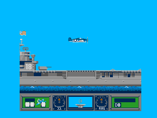
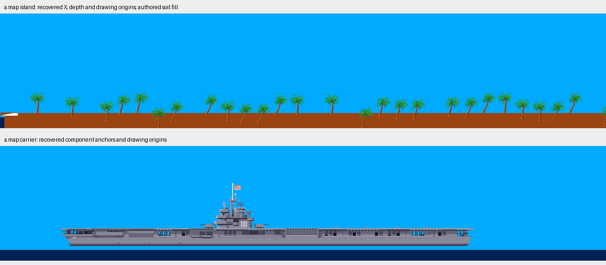

# Original mission strip: a.map

Completed 2026-11-11. The first source-backed mission prototype now reconstructs
the island and carrier layout from `maps/a.map`, including the original aircraft
reset X. It is a scenery adaptation with controllable flight, animated water and two viewing scales; mission
rules, collision, carrier motion and landing behavior remain future work.

```sh
./launch.sh mission-flight
# Or build without opening openMSX:
./build.sh projname=mission-flight
```

The ROM is `out/mission-flight/mission-flight.rom`, a 128 KiB ASCII8 image. Arrows
or joystick port 1 move, stationary T turns, and Space/fire resets altitude,
velocity and pose while retaining horizontal position. The aircraft starts
airborne at the recovered horizontal reset coordinate, not in a recovered
takeoff state. Extreme world positions can clip parts or all of some poses. A [fixed dashboard](dashboard.md)
now uses the original artwork at the bottom; its center is now a forward pilot display. See the [scenery fidelity pass](scenery-fidelity.md) for waves and automatic distance views.



This is an actual completed-raster capture from openMSX. Graphics-enabled
verification now passes on both reference configurations.

## Established map structure

All fifteen maps have an eight-byte big-endian header followed by a sequence
of big-endian 16-bit words. No map decompression is needed. Bounds, declared
size and observed reserved bits are checked before interpretation.

| Offset / bits | Observed meaning | Evidence |
| --- | --- | --- |
| Header +0, u32 | File byte count, including header | Exact size match in all fifteen inputs |
| Header +4, u32 | Aircraft reset X encoding: value×4−8 | Executable file 0x2b8c–0x2b96; copied into aircraft X at 0x3604 |
| Word index i | World X=i×8 | Eight-pixel stepping at 0x2d76 and X/8 lookup at 0x5110 |
| Word bit 15 | Draw an object from this entry | Draw path tests shifted bit 13 at 0x3882 |
| Word bits 2–10 | Nine-bit shape/object ID | Mask 0x7fc at 0x388c, ID lookup paths also use 0x1ff |
| Word bits 11–13 | Vertical offset, 0–7 multiplied by four pixels | Normal-scale draw path at 0x38ae |
| Word bits 0–1 | Surface class | Queried separately at 0x387c and 0x5120 |
| Word bit 14 | Unobserved/reserved variant | Zero in every supplied word; unsupported variants rejected |

For `a.map`, class 2 spans the island, class 1 spans the carrier, and class 0
spans sea/empty areas. These labels are supported by the associated artwork
and executable branches; they do not establish complete collision rules.
Repeated unflagged IDs are retained for those later queries. The parser does
not collapse them into a list of drawn objects.

The executable's world-name table begins at file offset **0x13ed4** and has
184 four-character entries followed by zero. Its first entries bind IDs 1/2
to `bchl`/`bchr`, 3 to `dugo`, 4/5 to `huta`/`hutb`, and 6–8 to the three palms.
IDs 31–39 bind carrier components, including hull sections, tower and guns.
The fixed table is copied into the combined world pointers at 0x5396. Other
IDs can represent loaded ship archives or special gameplay markers; no blanket
shape mapping is invented for them.

Instruction bytes supporting the core deductions are checked by
`tools/decode_mission.py`, and the executable and every decoded source map are
hashed. Capstone was used for exploratory disassembly only; it is not required
to reproduce conversion or run tests. The original machine code is not ported.

## Runtime surface and object queries

`Mission_Query(x)` now returns the same low eleven strip-word bits as the
original bounded query at executable file 0x50f0–0x5128: class in bits 0–1,
object ID in bits 2–10. The query's jump-table entry at 0x130e6 is also guarded
against the original executable bytes. The source routine returns class and
object ID in separate registers; the MSX API packs them into one word.

All 951 source cells participate, including entries whose drawing flag is
clear. Ninety-one runs occupy 364 bytes of resident ROM. A binary search finds
the first exclusive run end beyond X; no new map RAM or mapper changes are
needed. Negative X and X at or beyond the decoded 7,608-pixel strip return zero.
The source loader's extra allocated range remains deliberately excluded.

The compiled host query is compared against every source pixel and signed
coordinate extremes. During emulator traversal, `g_DisplaySurfaceWord` records
the query at the published aircraft X, and every captured frame checks it
against the original map. Sea, island and carrier classes are all exercised.
The diagnostic adds two bytes of static RAM.

This is collision input, not a height map or landing solver. Vertical offsets
belong to object placement; the authored flat soil and translated rendering
baseline are not recovered collision heights. Aircraft collision response,
carrier deck/elevator state and landing rules still require separate recovery.

## a.map layout and coverage

The file has 1,910 bytes, 951 payload words and 7,608 pixels of file-backed strip.
Its reset header is 1,760, giving **X=7,032**. The original loader allocates and
uses a size-derived range slightly beyond the available payload; this prototype
bounds navigation to the actual decoded words rather than inventing trailing data.

| Region / object | Source X or interval |
| --- | --- |
| Island class | 8–3976, end exclusive |
| First / second dugout | 1736 / 3224 |
| First / second intact hut | 2392 / 2712 |
| Carrier class | 6600–7360, end exclusive |
| Front / middle / rear hull anchors | 6720 / 6976 / 7232 |
| Tower anchor | 6912 |
| Aircraft reset X | 7032 |

Every drawing anchor uses its map X and depth, then subtracts the signed source
shape drawing origins. In particular, the three 256-pixel carrier hull sections
join at their recovered anchors. The 75 available normal-scale draw entries
include shoreline pieces, palms, huts, dugouts and carrier components.



Fourteen flagged entries remain explicitly unrendered. Thirteen refer to `bumb`,
which is absent from the normal-scale `world.shp` but present in `8thscale.shp`;
the reduced-scale graphic is not substituted into the normal-scale scene. One
uses special marker ID 275 (0x113), handled separately by executable logic near
0x3b6e. The complete original words and their positions remain in the export.
Carrier elevator behavior, parked aircraft and other dynamically drawn parts
are not reconstructed from ordinary static draw flags.

The source normal baseline is 151. The current 172-line MSX view uses 161,
keeping eleven lines below it; canvas baseline 201 is cropped by 40. This moves
the earlier carrier and ground strip down 17 pixels. Island fill uses source
color 17. Sprite depths/origins and horizontal anchors remain source-backed.
Waves use the original twelve shapes and separate `ocean.palette`, fitted to
five shared blue shades. Transparent crests preserve the hull behind them.
See [water extraction](water-artwork.md).
The automatic distant view uses `8thscale.shp` and the recovered height-186
threshold. Continuous vertical panning and complete original masking/dynamic
rendering remain future work. See [the fidelity notes](scenery-fidelity.md).

Structured outputs are [inventory](../assets_src/missions/inventory.json),
[instruction/name-table evidence](../assets_src/missions/evidence.json),
[all a.map words](../assets_src/missions/a-map.json), and
[placed/unrendered entries](../assets_src/missions/a-scene.json). The complete
source-palette adaptation is [a-source.png](../assets_src/missions/a-source.png).

## Current storage and rendering

Close and distant scenery share 490 cached 8×8 tiles (15,680 bytes) and a
6,356-byte compressed map, totaling 22,036 bytes in ROM banks 4–6. The table has
1,072 column offsets: 952 close columns and 120 distant columns. Both expand to
nineteen rows; runtime copies canvas rows 64–211 into screen rows 24–171.
Tile zero remains sky. IDs stack in vertical groups of nine, y=180–251 on
pages 2/3, so consecutive tile runs and solid fills can merge VDP commands.

The cartridge is 128 KiB ASCII8. Resident code/data occupy 26,549 bytes;
aircraft pixels use banks 8–10 and wave pixels use bank 11. The small
`Scenery_Read` routine is linked below 6000h and restores resident bank 1 before
returning to its callers. Normal flight performs no mapper switching. Actual
CPU-visible ROM bytes, not just mapper shadows, are checked at each capture.

Static RAM is 9,240 bytes plus the 452-byte IM2 reservation, stack and BIOS
workspace. Map/cache storage accounts for 8,954 bytes. Pilot frames occupy
verified gaps in the upper atlas; wave frames occupy unused bottom rows on
the display pages. All are disjoint from clean-aircraft backups. Runtime
composition writes only to the hidden page.

## Current acceptance and limits

The fidelity build uses eight VBlanks per presentation: nominal **7.5 fps NTSC /
6.25 fps PAL**. Twenty NTSC simulation steps or twenty-four PAL steps retain
nominal 150 Hz simulation between view rebuilds. The previous 20 fps target
cannot accommodate the richer close-view workload, including animated water
beneath the carrier. The earlier tile-flight and world-flight prototypes keep
their 30/25 fps targets.

Scale changes rebuild each hidden page. These deliberate pauses are measured
separately from regular frame deadlines; they currently take about 0.4 seconds
per page. Simulation pauses during the rebuild. Continuous zoom/panning and
faster transitions remain performance/fidelity work.


Final verification covers 54 NTSC and 61 PAL raster/VRAM snapshots,
with zero regular frame deadline misses. Maximum regular redraws measured
95.59 ms NTSC and 107.90 ms PAL. The eight-VBlank cadence
remains 7.5/6.25 fps. Both reports verify ROM SHA-256
`bb847b271968e155e63b687f505682097fabcaaf75067400920d5d61995c361c`.

Current measurements are retained in the [NTSC](mission/panasonic.json) and
[PAL](mission/pal.json) reports, with matching ROM hashes. The checks compare
all unmasked VRAM pixels, plus the NTSC completed raster against the close/distant scene,
aircraft, water phase and pilot profile. They cover both display pages,
fine-scroll phases, seams, source landmarks, world bounds, reset, immutable
atlases, actual bank restoration, hidden-page immutability and VBlank-safe
publication. Host input is blocked in the emulator harness so only its scripted
keyboard matrix can affect verification.

All 73 host tests pass, including exact strip/header round trips for all fifteen
maps, malformed inputs, executable guards, combined-scene tile/RLE round trips,
atlas overlap, every-pixel surface queries, bounds, and simulation grouping.
Earlier reports are retained separately, including the prior 20 fps side-map
and static-dashboard milestones. Those reports describe their own ROM hashes.

The pilot view is a forward-looking adaptation using original perspective
sprites. Its full projection, original instruments, carrier elevator/parked-aircraft behavior,
flight physics, collision and landing remain unported. Clear/set plane masks and the transparency-buffer fallback are now traced to
the original blitter; full original dynamic rendering remains future work. The shared 16-color palette
also approximates original colors. Physical mission-flight hardware testing
remains pending; the user's earlier successful tile-flight run is not such a
test.

```sh
python tools/decode_mission.py --check
python tools/convert_hellcat.py --check
python tools/convert_mission.py --check
python tools/convert_dashboard.py --check
python -m unittest discover -s tests -v
./build.sh projname=mission-flight
python tools/verify_world_flight.py --project mission-flight --output tools/.build/scenery-source-final
python tools/verify_world_flight.py --project mission-flight --machine C-BIOS_MSX2+_EU --output tools/.build/scenery-source-final-pal
```
