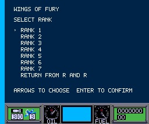
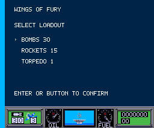

# P0: controls, inventory and game state

The release `mission-flight` profile now starts at rank selection: the
original's seven rank names, then the mission briefing (rank, mission number,
islands and ships: [mission-flow.md](mission-flow.md)) and loadout selection.
The screens use the menu font until their artwork is done.

| Input | Release action |
| --- | --- |
| Arrows / joystick 1 directions | [P1 throttle, stalls and takeoff](p1-flight.md) |
| Space / joystick trigger 1 | Machine guns; short presses and holds both fire guns |
| N / GRAPH / joystick trigger 2 | One selected-secondary release per logical press |
| Enter | Confirm menus/text; no airborne weapon action |
| Esc | Pause; only Esc resumes |
| Ctrl-R | New game at rank selection, retaining joystick inversion |
| Ctrl-F | Toggle joystick vertical inversion; keyboard arrows are unaffected |
| Ctrl-L / Ctrl-G | Load/save UI shells; return without changing the practice session |

N, GRAPH and trigger 2 are ORed before edge detection. Changing aliases while
another remains held does not create another press. The VBlank ISR reads hardware
at 50/60 Hz and queues logical changes in seven usable event slots. Context
changes flush pending actions and suppress held confirmation buttons until all
aliases of that button are released. Overflow discards stale events and
resynchronizes; it never replays a backlog of weapon releases.

A new game has three lives and a 30-bomb load. Loadout previews also encode 15
rockets and one torpedo. Those two choices cannot start a sortie until P3/P4 add
their weapon behavior. The HUD icon and stock follow the selected secondary;
gunfire does not spend that stock. Guns are provisionally unlimited because the
manuals do not establish a gun-ammunition limit. The small projectile pool remains
a rendering budget, with no inventory charge when a release cannot allocate a
slot. Oil/fuel remain initial state values and static gauges until P2/P5.

`mission-flight-debug` is a separate renderer-test profile: it starts in flight,
R resets altitude/velocity and replenishes the chosen load at the current X,
and stationary T requests a turn. These shortcuts are absent from the release
profile. Earlier flight/viewer profiles retain their own documented controls.

## Data and storage boundary

Portable `GameState` separates game progress, mission progress and sortie stock
from combat effects and renderer caches. `session.c` defines an explicit 32-byte,
version-1 little-endian wire record with CRC-8. It validates stock, rank, lives,
coordinates and velocities; decoding is transactional. The encoder requires
carrier eligibility supplied by the future carrier state machine. It does not
serialize pointers or VRAM addresses. P2/P5/P6 will extend/version the schema for
carrier/death, enemy/objective and campaign state before real saves are exposed.

The codec is host tested and is not linked into this ROM as a pretend storage
backend. Standard ASCII8 ROM has no writable persistence. P6 will use a separate
disk/MSX-DOS deployment profile with named files and a failure-safe write strategy;
no writable cartridge device has been assumed or verified. The current Ctrl-G,
Ctrl-L and Return from R & R screens say that storage is unavailable and return
to their calling context. Actual carrier eligibility, naming, disk writes and
loading are deferred to P2/P6.

## Bank and RAM boundaries

Dashboard RLE streams and secondary icons moved to immutable ASCII8 bank 12.
`Scenery_Read` restores resident bank 1 before returning. Both interrupt handlers,
input sampling and queue production remain in fixed bank 0 below 6000h. The ISR
uses RAM copies of the two palettes, so asset bank switching cannot substitute
palette bytes. Portable gameplay remains resident; future AI/content needs an
explicit banked-code budget rather than assuming unlimited resident growth.

The ordinary projectiles keep their three-slot, 36-byte simulation pool. Their
VRAM backups now cover the actual small round/bomb footprints while impact
crosses retain their full bounds. Publication uses the current eighth VBlank
when it has already opened during rendering, rather than wasting that window
and waiting for a ninth. Host-side interval-boundary queries retain coverage.

## Verification

Run the release scenarios separately from renderer tests:

```sh
./build.sh projname=mission-flight
python3 -m unittest discover -s tests
python3 tools/verify_p0.py --headless
python3 tools/verify_p0.py --headless --machine C-BIOS_MSX2+_EU --output tools/.build/p0-pal-headless
./build.sh projname=mission-flight-debug
python3 tools/verify_world_flight.py --project mission-flight --debug-profile --weapons --headless
```

`verify_p0.py` checks published game state against HUD digit/icon pixels, both
bank placement/restoration, fixed-bank ISR addresses and hidden-page immutability.
It exercises N/GRAPH overlap, short buffered presses, context consumption, pause,
restart, inversion and both storage shells. Both joystick triggers and joystick
inversion are injected at the actual PSG-read instruction boundary; this checks
the ISR mapping and alias logic, not an electrical joystick or host-pad driver.
It also reconstructs `*-vram.png` previews; these are not raster screenshots.

Current results: 95 host tests and 21 release snapshots on each of NTSC and PAL
pass. Graphical SDL renderer startup stalled during this run and hit the bounded
100-second timeout; fresh raster and physical-joystick sign-off remain pending.
Full renderer checks pass 58 NTSC/65 PAL visible-VRAM snapshots with zero
missed regular deadlines, including both scales, mapper restoration and trail
restoration. Maximum regular redraws are 88.65/94.22 ms at eight VBlanks per
presentation (7.5/6.25 fps). Scale rebuilds remain 0.27–0.32-second interruptions
per page; P1/P2 must not treat these prototype pauses as authentic behavior.
The earlier world-flight profile also passes [64 headless regression snapshots](p0/legacy-renderer.json)
with a 20.61 ms maximum redraw, covering the shared publication fix.
Reports: [NTSC release](p0/ntsc-release.json), [PAL release](p0/pal-release.json),
[NTSC renderer](p0/ntsc-renderer.json), [PAL renderer](p0/pal-renderer.json).

The final release uses 30,034 of 32,768 resident bytes (2,734 free), plus the
7,117-byte immutable dashboard bundle in bank 12. SDCC static data/initializers
use 9,646 bytes, excluding the lower IM2 reservation, stack and BIOS workspace.
The debug profile uses 30,077 resident bytes. The control queue is 33 bytes on
SDCC, game state 20 bytes, combat state 36 bytes and session wire record 32 bytes.
No enemy pool or future campaign content has been silently budgeted as free.




P1 flight semantics and leftward carrier takeoff are now implemented with
[provisional tuning and separate evidence](p1-flight.md). Landing/elevator and
service follow in P2. No new dashboard-fidelity claim is made by this increment.
