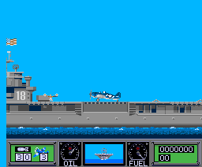
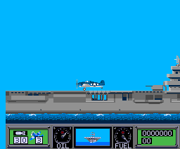
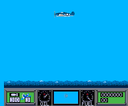
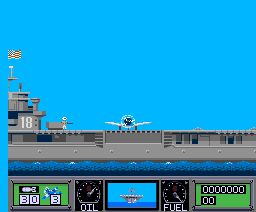
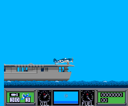
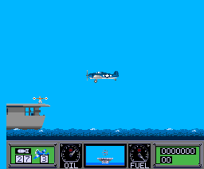
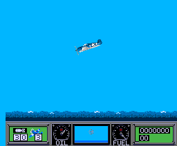

# P1: flight semantics and leftward takeoff

**Superseded 2026-11-14:** the tuning model below was replaced by the
[flight model rebuilt from the original](flight-model.md). This page records
the P1 milestone.

Follow-up: the [carrier elevator and service increment](carrier-elevator.md)
now replaces the direct deck start with an emergence animation. Its report
contains current validation and memory measurements; the P1 evidence below
records the earlier flight/taxi milestones.

The release `mission-flight` profile now starts its practice sortie on the
carrier, facing left. Hold Left to accelerate along the deck; add Up near the
bow to climb away. Neutral airborne input maintains approximately three-quarter
throttle. Horizontal input commands full throttle in that direction, diagonals
climb/dive. Up alone holds a nose-up stall with gentle altitude loss; releasing
Up returns to level flight. A Down tap latches a moderate nose-down dive until
Up or horizontal steering changes the attitude.
Opposed directions cancel independently on each axis.

Reversing horizontal input in flight starts a committed banked turn. The simulation retains the
old heading during the bank, commits the new heading at its end and charges
altitude throughout. Climb input compensates for that loss. Animation samples
that same simulation clock; it cannot independently start or delay a turn.
Weapons use the simulation heading on each weapon tick. Joystick inversion stays
in the input sampler and does not invert keyboard arrows.

The debug profile retains its existing free-axis flight, airborne reset and R/T
shortcuts. Older viewer/benchmark profiles also retain their existing controls.

## Geometry and evidence boundary

The decoded `a.map` hull placements establish the rendered extent:
`fcar` starts at X=6593, followed by `mcar` at 6849 and `rcar` at 7105; the last
section ends at X=7361 (exclusive). Their drawing Y=169 becomes viewport row 129
after the existing 40-row crop. This differs from the map's class-1 interval
[6600,7360), which is not an exact deck silhouette.

The original wheels-down poses `hc40` (right) and `hc41` (left) are now included
in the aircraft atlas. Their crop has offset Y=8 and height=16. The renderer
projects it as `145 - (1200 - y) + 8`, so logical Y=1160 places the tires
immediately above deck row 129. A host test checks this against both conversion
manifests. Source wheel gray 25 maps to the existing dark-gray slot 6; all
original nontransparent pixels and drawing origins are retained.

X=7032 remains a provisional parking location inside that decoded deck extent.
It is the recovered loader reset X, **not** a recovered elevator coordinate.
Takeoff speeds, stall behavior, turn motion and launch-zone width need timed
Amiga comparison before a fidelity claim. No new original-game recording was
available in this increment. Manual direction/control requirements come from
the existing [English Amiga reference](AMIGA_ENGLISH_REFERENCE.md) and
[manual requirements](MANUAL_FUNCTIONAL_SPEC.md).

Provisional constants at 150 simulation ticks/second, with Q8 velocities:

| Quantity | Current value |
| --- | --- |
| Full / neutral speed | 205 / 154 (rounded 3/4) |
| Ground acceleration | +1 velocity unit per 5 simulation ticks |
| Airborne speed and vertical acceleration | 5 velocity units per tick |
| Diagonal climb / dive vertical target | -96 / +96 |
| Stall speed / vertical target | 32 / +32 |
| Latched dive speed / vertical target | 154 / +48 |
| Turn duration / additional downward target | 110 ticks / +64 |
| Climbing launch zone | Final 64 deck pixels before the bow |
| Minimum climbing launch speed | 154 |

Before reaching the launch zone, the aircraft stays on its wheels on the deck.
Ground movement now has temporary end stops at X=6617 and X=7336, leaving room
for the full aircraft outline inside the recovered hull extent. Holding an
outward direction cannot push it into the water. Up+Left near the bow still
allows takeoff after reaching speed; rightward taxiing cannot launch. Landing, ground impact,
crashes, elevator transit, service and fuel are P2 work; this increment does not
supply a reusable carrier collision/landing solver. Air/world limits still clamp
positions. Render-scale rebuild pauses remain an existing limitation.

## Automatic gear, deck heave and signalmen

Ground mode starts with the original inclined, tail-down pose: `hcoc` facing
left, or `hc21` facing right. It keeps that pose below Q8 speed 154, then selects
the horizontal wheels-down `hc41`/`hc40` pose at the same speed threshold used
for takeoff eligibility. Slowing below that speed restores the tail-down pose.
A full-throttle run from rest reaches that speed after 770 simulation ticks
(5.13 seconds), tuned to the user's reported approximately five-second original
run. Speed increases throughout the run; parked time cannot accumulate throttle
credit. Releasing throttle clears the partial acceleration step. Airborne
acceleration and the existing near-bow launch condition are unchanged. This is
a speed-dependent ground transition, not a timed pose change or a pitch-key action.
Both poses anchor their lowest opaque tire row immediately above deck row 129,
so changing artwork does not move the wheels through the deck. Carrier heave
continues to move the grounded aircraft with the deck. On takeoff, removing
ground support automatically returns to the normal flight poses. A level or
descending, left-facing aircraft deploys gear in the low inbound carrier region:
X=6721..7553 and Y=1080..1160, with no active bank. Climbing, turning or leaving
that region retracts it. These thresholds are provisional MSX tuning; they are
not recovered hook-capture conditions. Actual landing remains P2 work.

The grounded aircraft no longer cancels the carrier's vertical scroll. Its
wheels, the deck and both crew members move through the same 0/1/2-pixel heave.
Airborne aircraft still compensate for that scroll and keep independent height.

The `a.map` special marker ID 159 (`fgyx`) occurs at X=6968 and X=7344. The first
is left of the parked plane and the second is at the right end of the deck.
`world.shp` supplies `fgy0`..`fgy7` and `fgy8`..`fgyf`: two arm sequences for the
signalman. The original executable draws these two groups over one another at
these markers (file offsets 0x3ccc..0x3d2e). Conversion preserves their origins
and record hashes, overlays the two arm cycles and retains the exact static
scenery behind them. Current synchronized 10 Hz playback is an MSX adaptation;
the original state-dependent arm timing is not claimed as recovered.

The crew frames live in immutable ROM bank 13 and 32 disjoint 22x7 VRAM pieces,
with two pieces per pose/location. They replace the complete background patch
before aircraft composition, so moving arms erase cleanly. Dirtying terrain rows
11..13 under each patch also forces repaint on scroll-ring reuse; this prevents
signalman flags from leaving stray pixels over newly scrolled sky.

## Bidirectional taxi and ground turns

Left and Right now taxi in either direction. A reversal first brakes to a stop,
then commits to a turn through the front view before accelerating in the new
heading. The plane remains in ground mode, at constant deck height with gear
out and carrier heave applied; ground turns never charge airborne altitude loss.
Neutral brakes and keeps the current heading. A direction change during a turn
does not restart its animation; the next reversal can begin after completion.

The original gear-down front/right artwork is `hc1b`, `hc1c`, `hc1d`, `hc1e`,
`hc1f`, ending at the original side view `hc21`. The left endpoint is the stored
`hcoc`; four left quarter views are explicit reflections of `hc1c`..`hc1f`.
The selected left-to-right sequence has eleven poses: five increments from left
side to front, followed by five to the right side. The right-to-left sequence
reverses it. Each increment takes 24 simulation ticks, so a complete reversal
lasts 1.6 seconds after braking and every pose can be published on PAL or NTSC.
The supplied artwork is verified, but the selection/timing is an MSX adaptation;
this is not a claim to have recovered the original ground-turn state machine.

VRAM cannot hold all nine extra quarter/front poses at once alongside the
existing scenery, pilot and effect atlases. The first 53 aircraft shapes remain
resident; the nine additional poses share one streamed 46x15 cache in the unused
lower rows of the third reduced-aircraft reservation. A pose uploads only when
it changes. Disjointness tests include that cache against every actual far-pose
rectangle and all other allocations. The aircraft atlas now has 62 shape records.

The extra ROM payload continues in bank 14, leaving wave bank 11, dashboard bank
12 and crew bank 13 intact. Conversion pads the bank-10/bank-14 transition so no
single shape crosses the noncontiguous boundary. Both the initial cache loader
and streamed uploads restore the resident mapper bank before returning.

## Validation

Use the project's Python environment (`tools/.build/venv/bin/python` in this
workspace) with Pillow installed:

```sh
python3 -m unittest discover -s tests
./build.sh projname=mission-flight
python3 tools/verify_p0.py --headless --output tools/.build/p1-ntsc
python3 tools/verify_p0.py --headless --machine C-BIOS_MSX2+_EU --output tools/.build/p1-pal
./build.sh projname=mission-flight-debug
python3 tools/verify_world_flight.py --project mission-flight --debug-profile --weapons --headless
```

All 110 host tests pass, including thirteen P1 scenarios covering all nine
stick positions in both headings, neutral/opposed inputs, stall/dive targets,
turn cost and compensation, animation/simulation agreement, deck-art geometry,
continuous leftward takeoff, world bounds, automatic gear eligibility, progressive five-second acceleration,
and equal PAL/NTSC game-time traces.
The source/atlas tests additionally cover the crew arm records, map markers,
converted poses and disjoint cache allocation.

The release harness passes 57 published snapshots on each standard, including
a normal keyboard deck roll/takeoff, bank/turn completion and a compensated
turn, a return approach with gear extended, a climb-away with gear retracted,
a slow tail-down roll, continued acceleration past four seconds without leveling,
stationary deck captures at all three heave heights, every ground-turn pose in
both directions, and held-input checks at both end stops, followed by the P0 menus, weapons, input aliases, native joystick-bit
injection, inversion, pause and restart checks. Both runs report zero missed
regular frame deadlines. It compares every visible gameplay pixel against the decoded scenery, aircraft,
crew, waves, cockpit and weapon composition. It also checks HUD pixels, immutable visible pages
while rendering, fixed-bank ISR placement and mapper restoration. Previews now
use the actual published camera and heave when reconstructing VRAM.

Evidence: [NTSC](p1/ntsc-release.json), [PAL](p1/pal-release.json).
The debug renderer regression passes 58 NTSC / 64 PAL full-VRAM snapshots,
with maximum regular redraws of 88.66 / 94.26 ms and no missed regular deadlines.
Reports: [NTSC renderer](p1/ntsc-renderer.json),
[PAL renderer](p1/pal-renderer.json). A fresh graphical
openMSX invocation exited before captures, so the images below are inspected
VRAM reconstructions, not raster screenshots. Physical joystick and FS-A1WX
acceptance remain pending.

Resident release code/data occupy 32,566 of 32,768 bytes (202 free). Static
SDCC data plus initializers occupy 9,653 bytes before IM2, stack and BIOS
workspace. The release flight state adds three bytes for mode and turn state;
the debug profile remains 30,557 resident bytes.








Next gameplay increment: P2 carrier approach/landing, elevator/service, fuel,
damage and lives. Recover elevator geometry and landing envelopes before calling
that gate faithful; the current deck constants alone do not establish them.

## Held stall and persistent dive

The release now matches the supplied maneuver captures: Up alone slows the
plane, raises its nose and produces a smooth descent. Releasing Up returns it
to level flight as vertical speed eases to zero. Down alone selects a moderate
dive; neutral input retains that attitude and descent after the key is released.
Up replaces the dive with a held stall, and its subsequent release levels the
plane. Horizontal controls retain their existing powered steering and diagonal
climb/dive behavior and replace the latched dive.

The original source poses already in the atlas supply the artwork: pitch index
3 (`hc04`, mirrored for left flight) for the nose-up stall, and index 6 (`hc07`,
mirrored for left flight) for the nose-down dive. Stall pitch is independent of
positive downward velocity. A low inbound stall uses the original gear-down,
nose-up resting pose instead of flattening the aircraft to draw its wheels.
The portable core tests both headings and this carrier-approach presentation.

Provisional Q8 targets are 32 horizontal / +32 vertical during a stall and
154 horizontal / +48 vertical during the latched dive, approached in increments
of five per 150 Hz simulation tick. These are MSX tuning values based on the
observed behavior, not recovered original physics. Input-event handling preserves
a Down tap captured by VBlank even when the key is released before the next
foreground update. An Up press also cancels that stored dive. Generic debug
profiles keep their original free-axis controls.

Validation: 121 host tests pass, including held stall, release to level, dive
persistence, recovery, both headings, gear presentation and PAL/NTSC grouping.
Release emulator checks pass 83 snapshots on each video profile, with complete
visible pixel comparisons for the original poses. The Down-tap scenario holds
the foreground while VBlank samples the complete press/release, then verifies
continued descent after release. Existing carrier, takeoff, taxi, weapon,
keyboard/joystick, pause and reload scenarios also pass.
[NTSC results](stall/ntsc.json), [PAL results](stall/pal.json).
Both release and debug ROMs build; the release uses 32,748/32,768 resident bytes.
Unused legacy pitch sampling is omitted from P1 simulation; presentation derives
attitude from its flight mode, velocity and committed turn clock.

These images reconstruct VRAM; they are not raster or hardware captures.




### Descent-rate tuning

Following the user's comparison with the original, the pure Up stall and
latched Down dive now have half their previous vertical targets: +32 instead
of +64 and +48 instead of +96 in Q8 pixels per simulation tick. Settled descent
is 18.75 pixels/second for the stall and 28.125 pixels/second for the dive.
Horizontal speeds, the original poses, dive persistence and release/recovery
controls retain their behavior. Powered diagonal climb/dive targets are unchanged.
These rates follow the user's estimate rather than a recovered Amiga timer.

All 121 host tests pass, including exact one-second settled descent distances
in both headings. The rebuilt release passes all 83 emulator snapshots on each
video profile, including pose, persistent-dive, recovery and carrier checks:
[NTSC](stall/slower/ntsc.json), [PAL](stall/slower/pal.json).
