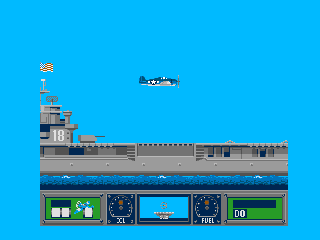
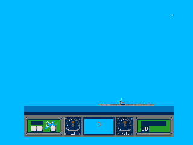

# Scenery fidelity pass

This pass prioritizes the original scenery and viewing behavior over collision
work. Run `./launch.sh mission-flight`. The cartridge is now 128 KiB ASCII8.

The carrier and island baseline moved down 17 pixels. The original baseline is
151 in a 162-line view; this 172-line view puts it at 161, preserving eleven
lines below it. Source-canvas baseline 201 is cropped by 40 lines. The earlier
184−40 placement left a 28-line ground strip. Island fill uses source index 17
rather than the previous authored index 14. Sand is composited after scenery
so it covers palm roots. The original beach silhouettes replace the rectangular
fill at both island ends. The normal sand strip retains the source beach
height of five pixels, with animated water continuing underneath. Aircraft
placement also removes the
25×16 logical-frame reference offset so the recovered world position is the
plane's drawing anchor.

All twelve original `wava`–`wavl` shapes now animate at the waterline, including
beneath the carrier. The island occludes the wave band. Source order decrements
through twelve frames; the MSX adaptation advances every twelve simulation
steps. Waves now use the original separate `ocean.palette` CMAP instead of the
previous hand-authored foam mapping. Source zero is transparent; source sea
color 19 remains dark blue. Two mission palette slots take their RGB3 values
from ocean body/crest colors 10/8. This also changes those shared blue tones
on the aircraft. Five shared blue shades still approximate the original ramp.
Water intervals follow each scanline of the sand silhouette. Odd edge pixels
use logical copies; identical clipped intervals merge into taller commands.
The six rows below the sand animate across the full island width.

The first two wave rows blend transparently over clean scenery, preserving
the hull behind crest gaps. Clean waterline backups restore the crest background before each phase;
carrier heave uses four rows rather than two. The backups occupy Y=688–691
and 764–767; the other nine source rows are opaque. This
prevents both cyan cutouts and animation trails. Extraction details and the
source/MSX comparison are in [water artwork](water-artwork.md).

The dashboard center is a **forward pilot view**, replacing the earlier side-on
miniature map. It uses the original `3dl` ground strips, `3dc` carrier perspective
sprites and fixed `targ` reticle. Eight altitude profiles and a forward surface
query select the view. This restores the intended viewpoint; the original
continuous projection, target-distance rules and dynamic entities are not yet
ported. Oil/fuel, inventory and score behavior remain pending.

The recovered altitude test switches above height 186. The distant view uses
`8thscale.shp` with one screen pixel per eight world pixels, its source drawing
origins, and all 27 original `lpn…` pitch/bank aircraft records. It returns to close view at height
186 or lower. The simple flight core now spans heights 0–1200, starts at height
92, and retains nominal 150 Hz updates between redraw transitions. It remains
a control prototype, without original flight dynamics or collision response.
Continuous close-view vertical scenery panning still needs a later pass.
The distant view now fills the sea below the horizon, removing the cyan gap
beneath the carrier and shore. See [altitude rendering](altitude-view.md).

The original blitter establishes that header bytes 12/13 clear and set
selected destination planes; they are not a base-colour OR fill. The current
mission decoder uses those masks and the raw-plane transparency mask. This
corrects distant foliage and carrier shades. Large hulls use the original
1,040-byte mask-buffer fallback. The older prototypes retain their legacy
conversion for reproducibility. Details are in [the shape format](format-shp.md).
The carrier now waves its flag, turns its radar and heaves by two pixels.
See [carrier effects](ship-effects.md) for the source artwork, timing and
waterline compositing. Elevator, parked aircraft and other dynamic objects
remain outside this pass.

The renderer stores close and distant columns in one 490-tile dictionary and
6,356-byte compressed map. Tiles occupy vertical groups of nine in pages 2/3,
rows 180–251. Pilot frames are packed into verified gaps in those atlas pages;
waves occupy unused lower display-page rows, with three tails in the upper atlas. Aircraft footprint
backups remain disjoint. Aircraft pixels load from ROM banks 8–10 and waves
from bank 11; the small bank reader restores resident bank 1 before returning.

The current fidelity build targets **7.5 fps NTSC / 6.25 fps PAL**, with eight
VBlanks per presentation and 20 NTSC or 24 PAL simulation steps.
The earlier 20 fps target could not accommodate the richer close-view redraws.
Changing scale rebuilds each hidden page and currently pauses for roughly
0.4 seconds per page. These deliberate transitions are measured separately
from regular frame deadlines. Faster presentation and scale transitions are
remaining performance work.

Executable guards cover the original baseline, player anchor, wave phase and
draw path, pilot horizon/window, and altitude threshold. Generated-data checks,
host tests and full VRAM/raster comparison validate both scales, animation
phases, original sprite caches, mapper restoration, page seams and bounds.
See the [NTSC](mission/panasonic.json) and [PAL](mission/pal.json) reports for
measurements and the final ROM hash. Physical hardware is not yet verified.

Final verification covers 54 NTSC and 61 PAL raster/VRAM snapshots,
with zero regular frame deadline misses. Maximum regular redraws measured
95.59 ms NTSC and 107.90 ms PAL. The eight-VBlank cadence
remains 7.5/6.25 fps. Both reports verify ROM SHA-256
`bb847b271968e155e63b687f505682097fabcaaf75067400920d5d61995c361c`.
