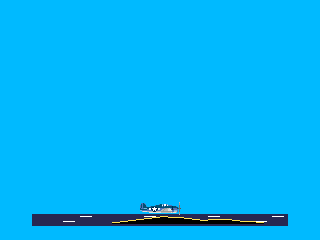

# Scenery restoration and scrolling benchmark

The ROM now has an opt-in synthetic landscape strip and transparent aircraft
compositing. This is a measured software-copy baseline toward B3, not completion
of the scrolling-world milestone. Original maps, world-space flight, streamed
terrain columns and V9958 horizontal-scroll registers remain future work.

## Try it

```sh
./launch.sh
```

The launcher builds the ROM and opens `Panasonic_FS-A1WX-512K`. It works from
another working directory and stops if the build fails.

- **S:** show/hide the benchmark strip at the bottom of the display.
- **P:** pause/resume its camera.
- **R:** reverse the camera direction.
- Existing arrows/joystick movement, Space/fire reset, stationary T turn and
  idle 1/2/3 pose controls remain available.

The strip is deliberately simple authored test imagery, using the existing
palette. It repeats after 512 pixels. Its independent camera advances at a
nominal 60 px/s, quantized to even pixels for byte transfers. P and R preserve
camera position; hiding the strip freezes its camera. Space resets the aircraft
only. There is no terrain collision or camera-follow behavior yet.



## Renderer and memory

Aircraft packed pixels upload once at startup to an atlas in VRAM. Generated
metadata gives each shape's atlas coordinates. LMMM with transparent IMP skips
zero pixels, so scenery shows through the aircraft's transparent background.
The hidden page's old aircraft rectangle is cleared first, its clean scenery
strip is copied next, and the new aircraft is composited last. HMMM splits the
scenery copy at the 256-pixel source-page boundary, including the 512-pixel wrap.
Disabling scenery clears the strip separately on each reused display page.

| VRAM pages | Rows | Use |
| --- | --- | --- |
| 0 and 1 | 0–211 | Double-buffered visible pages |
| 2 and 3 | 0–179 | Aircraft atlas, 21,370 populated bytes total |
| 2 and 3 | 180–195 | Reserved gap |
| 2 and 3 | 196–211 | Two halves of the clean 512×16 scenery strip |
| All pages | 212–255 | Unused |

All four 32 KiB pages are assigned to this layout. The ROM occupies 28,005
bytes of the 32 KiB target, leaving 4,763 bytes. Static data occupies 114 bytes,
plus the 452-byte IM2 reservation, stack (including a 128-byte startup row
buffer) and BIOS workspace. Neither the engine copy nor original assets change.

An initial 32-row strip exceeded the NTSC whole-loop budget when movement was
added. The retained baseline uses 16 rows. Copying a taller landscape every
frame needs another strategy; this result does not establish a budget for a
full-screen scenery copy or combat.

If drawing finishes after its scheduled interval, the scheduler counts a miss
and waits for a fresh VBlank before publishing. It does not publish immediately
in the active display area. The benchmark checks this recovery separately by
injecting a two-tick delay after rendering.

## Acceptance evidence

| Configuration | Publication samples | Median interval | Maximum redraw | Natural misses |
| --- | ---: | ---: | ---: | ---: |
| Panasonic_FS-A1WX-512K | 490 | 33.377 ms | 20.12 ms | 0 |
| C-BIOS_MSX2+_EU | 410 | 39.873 ms | 19.97 ms | 0 |

These are openMSX emulated-machine timings at standard machine speed.
Redraw includes restoration, scenery copy and aircraft composition; publication
intervals include input and simulation. Measurements cover this scene and
input sequence, rather than a worst-case budget for future gameplay.

Fourteen full-page comparisons per machine cover enabling/disabling scenery,
aircraft overlap and turns, both source-page seams, ring wrap, pause, reverse,
and returning to sky after moving away. Every snapshot also checks that all
49 cached aircraft shapes and both clean scenery strips remain unchanged.
Page publication stays in VBlank. A separate injected overrun is counted once
and publishes during the next VBlank.

All 46 host tests pass, including atlas bounds, alignment and overlap checks.
The existing movement regressions pass on both machines (11 snapshots each),
stationary and clipped turns pass on both, and the five-pose idle check passes.
Sky-only maximum redraw is now about 10.26 ms on Panasonic, compared with
13.77 ms in the preceding CPU-upload renderer. Actual Panasonic hardware and
physical joystick testing remain pending.

Retained JSON reports identify the tested ROM SHA-256:

- [Panasonic scrolling](scrolling/panasonic.json)
- [PAL scrolling](scrolling/pal.json)
- [Panasonic movement](scrolling/panasonic-flight.json)
- [PAL movement](scrolling/pal-flight.json)
- [Panasonic turns](scrolling/panasonic-turns.json)
- [PAL turns](scrolling/pal-turns.json)
- [Idle poses](scrolling/poses.json)

## Reproduce

Use Python with `requirements.txt` installed, a host C compiler, SDCC and openMSX:

```sh
python tools/convert_hellcat.py --check
python -m unittest discover -s tests -v
./build.sh
python tools/verify_scrolling.py
python tools/verify_scrolling.py --machine C-BIOS_MSX2+_EU --output tools/.build/scrolling-pal
python tools/verify_flight.py
python tools/verify_turns.py
python tools/verify_screen5.py
```

The scrolling check runs for about 16 emulated seconds after boot. Screenshots,
128 KiB VRAM captures and timing logs stay under its ignored output directory.

Next: benchmark V9958 horizontal scrolling and incoming-column updates with a
larger scene, then connect world coordinates to a following camera. Use the
measured VRAM layout and ROM headroom to choose storage/mapper requirements
before adding original map graphics. Original map decoding and flight dynamics
remain separate research tasks.
