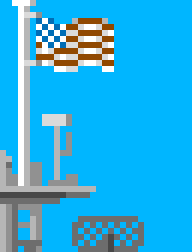
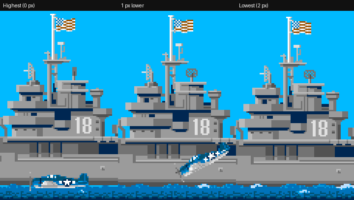

# Carrier flag, radar and heave

The original normal-scale `world.shp` has four combined carrier overlays:
`flg3`, `flg4`, `flg5`, `flg6`. Each is 32×42 with drawing origin (6,115).
They contain both the changing cloth and the turning radar, plus opaque sky
pixels that erase the preceding pose. They are drawn at the tower's world
anchor 6912 and baseline 201, yielding canvas (6906,86), screen Y=46.
The executable selects them through shape slots 180–183 near file 0x3d38.

`tools/convert_ship.py` preserves the decoded source indices and each original
record hash, then maps them to the existing mission palette. Source files are
unchanged. The four frames occupy 24 disjoint 16×14 VRAM rectangles, six per
frame. The generator and host tests check them against aircraft, terrain,
pilot, wave-tail and background caches.

The flag/radar playback advances every 30 simulation ticks (5 Hz). Carrier
heave advances every 45 ticks through offsets 0,1,2,1, giving one-pixel steps
and a two-pixel total excursion. These timing intervals are explicit MSX
adaptations; the original combined artwork and observed displacement are
retained, without claiming exact original animation timing.

Heave uses the MSX vertical scroll register while the close carrier is in
view. Aircraft and water coordinates compensate for the offset, keeping their
screen positions fixed. The dashboard interrupt restores zero vertical scroll;
its line number compensates for the scroll offset. A uniform one-pixel guard
line at row 171 lets the reset settle before the panel begins at row 172. The same scroll state is restored at every VBlank, even
when no new frame is published. The distant view keeps its current source art;
a two-world-pixel excursion is below its 1:8 display resolution.

Transparent wave crests must expose the hull at its current height. Each page
restores its clean waterline background before composition. Carrier views save
four rows (159–162); views without heave use only the original two crest rows.
The four-row backups occupy verified 256×4 gaps at Y=688 and 764. The fixed
water band is then composited over the moving lower hull; it does not move
with the ship. Aircraft draw after the water.

Vertical scrolling wraps the first two display rows to source rows 254–255.
Those rows therefore stay completely sky-colored. The last two rows of wave
frames 3,7,11 have moved to three contiguous 96×2 rectangles in the upper atlas.
All original wave pixels remain cached; no wave artwork is discarded. The
emulator verifies every cached wave and carrier frame and both blank wrap rows
at every snapshot, as well as all visible VRAM and completed raster pixels.

Regenerate and check the assets with:

```sh
python tools/convert_dashboard.py
python tools/convert_ship.py
python tools/convert_dashboard.py --check
python tools/convert_ship.py --check
```





Final verification covers 54 NTSC and 61 PAL raster/VRAM snapshots,
with zero regular frame deadline misses. Maximum regular redraws measured
95.59 ms NTSC and 107.90 ms PAL. The eight-VBlank cadence
remains 7.5/6.25 fps. Both reports verify ROM SHA-256
`bb847b271968e155e63b687f505682097fabcaaf75067400920d5d61995c361c`.

All 73 host tests pass. Resident code/data occupy 26,549 bytes and static RAM
uses 9,240 bytes, excluding IM2/stack/BIOS. Physical hardware testing remains
pending.
