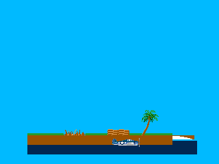
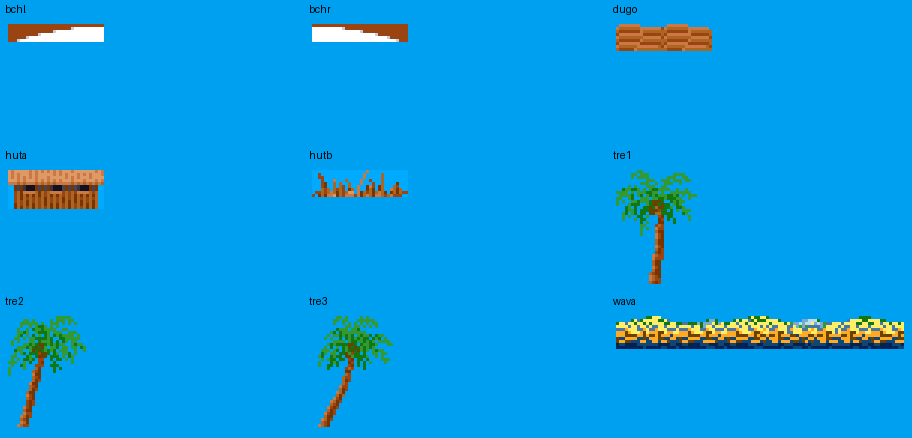
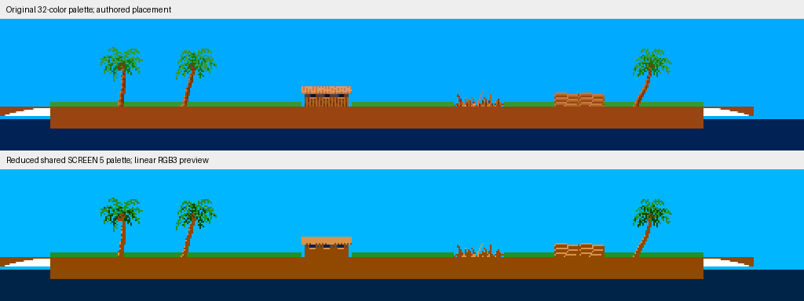

# Original artwork as SCREEN 5 terrain tiles

> **Retired 2026-11-13.** This build no longer exists; the mission ROM
> absorbed its renderer. Source is in git history up to commit `af61737`.


Completed 2026-11-11. The `tile-flight` prototype replaces procedural scenery
with an authored island scene built from original world graphics. It retains
world-space flight, camera following and transparent aircraft composition.

```sh
./launch.sh tile-flight
# Build only:
./build.sh projname=tile-flight
```

The launcher selects ASCII8 explicitly. The ROM is
`out/tile-flight/tile-flight.rom`, 65,536 bytes. Arrow keys/joystick port 1 fly;
stationary T turns; Space/fire resets altitude, velocity and pose while retaining
horizontal position. Terrain collision is not implemented.



## Decoding and evidence

All 140 records in the preserved `world.shp` pass the existing bounded planar
decoder. Nine inspected records are exported to `assets_src/world/` with
original indexed pixels and palette, headers, byte offsets and hashes:

| Records | Padded dimensions | Visual result |
| --- | --- | --- |
| bchl / bchr | 32×6 | Reflected shoreline pieces |
| tre1 / tre2 / tre3 | 32×38 / 32×37 / 32×37 | Three palm shapes |
| huta / hutb | 32×13 / 32×9 | Hut and ruined-hut candidates |
| dugo | 32×9 | Dugout/sandbag position candidate |
| wava | 96×11 | Wave/foam candidate |



Unlike the aircraft, the shorelines have a nonzero header base color: 14.
Applying the existing base-OR hypothesis reconstructs colors 14, 30 and 31;
the pair is an exact horizontal pixel reflection. This and the recognizable
graphics support the decode, while original-game drawing/masking behavior for
these variants remains provisional. Source zero is skipped when layering;
some records contain opaque sky index 1. Source names alone do not identify
gameplay roles: for example, the decoded `rock` is a ROCKETS UI label and was
excluded from the terrain subset.

The 4,096-pixel scene places five authored islands, palms, hut/dugout candidates
and wave instances. Original drawing origins position the objects; land strips
and grass bands are authored fills using original palette colors. This is not
an original mission, map-format decode, or recovered object-placement sequence.
Waves are static; their original animation timing is not established.

## Palette and tile size

The shared palette keeps aircraft/sky entries 0–11 exactly unchanged and uses
12–15 for two greens and two soil colors. Terrain source colors are mapped by
nearest squared distance after quantization to RGB3. This loses original color
detail, especially warm wave/foam colors and soil shades. PNG comparisons use
the original 32-color palette and linear RGB3 expansion; screenshots are actual
openMSX output with its display color transform.



Both tile sizes reconstruct the entire converted scene losslessly:

| Tile size | Unique tiles | Dictionary | Column-major map | Total |
| --- | ---: | ---: | ---: | ---: |
| 8×8 | 94 | 3,008 bytes | 5,632 bytes | 8,640 bytes |
| **16×16** | **44** | **5,632 bytes** | **1,536 bytes** | **7,168 bytes** |

The chosen 16×16 representation has the smaller combined footprint and less
RAM for map IDs. An eight-pixel incoming strip copies one half of each tile.
The map covers y=128 onward; the last tile has four visible rows and padded
sky below. Rows 128–143 are uniform sky and 208–211 uniform ocean; generation
and tests enforce these contracts. Only four intermediate tile rows vary.

This is a storage comparison for one authored scene, not proof that 16×16 is
best for every original mission. The compiled tile/map bundle, scene reference,
previews and provenance live in `assets_msx/terrain/`.

## Streaming and mapper layout

The [world-flight renderer](world-flight.md) still alternates two 256-pixel
single-page rings with an eight-pixel left mask. Every hidden-page redraw
restores its previous aircraft footprint, copies changed terrain half-tiles
from VRAM using HMMM, saves the next footprint, and draws the aircraft via
transparent LMMM. Cached tile IDs track each physical strip independently on
both pages; unchanged half-tiles need no copy. Their source half is determined
by the physical strip's eight-pixel position within a tile.

| Location | Use |
| --- | --- |
| Pages 0/1, rows 0–211 | Alternating scrolling display pages |
| Pages 0/1, x=0–43, rows 212–247 | Clean aircraft footprint backups |
| Pages 2/3, rows 0–179 | Existing aircraft atlas, unchanged |
| Page 2, rows 180–227 | 44 terrain tiles, 16 per atlas row; unused cells remain free |

Tile pixel data needs 5,632 VRAM bytes. The current reserved layout can hold
128 tiles across the lower bands of pages 2/3 without touching aircraft data.
Source/destination comparisons verify those allocations are disjoint.

The previous 32 KiB ROM had only about 3.4 KiB free, less than the 7 KiB bundle
alone. The prototype therefore uses **64 KiB ASCII8**, with the resident code
and aircraft data in segments 0–3 and the tile/map bundle in segment 4.
During startup, the loader maps terrain through CPU bank 1 (6000h–7FFFh),
uploads tiles to VRAM, copies 1,536 map IDs into RAM, then restores segment 1.
Normal scrolling needs no mapper switching.

The verifier checks linked loader boundaries and the upload routine remain
outside the temporary bank window. At every snapshot it checks both mapper
shadow values and actual CPU-visible cartridge bytes against the ROM's first
32 KiB. ROM bank payload placement is also compared with the generated bundle.

Resident ROM content occupies 29,847 bytes before its 32 KiB boundary; segment
4 uses 7,168 of 8,192 bytes. Segments 5–7 are available for later data. Static
RAM is 1,912 bytes, plus the existing 452-byte IM2 reservation, stack and BIOS
workspace. This is a validated prototype allocation, not a final-game capacity
estimate or a physical cartridge compatibility result.

## Timing and acceptance

| Emulated machine | Publications | Median interval | Maximum redraw | Misses | Snapshots | Hidden-page checks |
| --- | ---: | ---: | ---: | ---: | ---: | ---: |
| Panasonic_FS-A1WX-512K | 2,811 | 33.376 ms | 21.819 ms | 0 | 78 | 2,081 |
| C-BIOS_MSX2+_EU | 2,353 | 39.873 ms | 24.341 ms | 0 | 71 | 1,734 |

These are standard-speed openMSX results for the acceptance trajectory. Redraw
covers aircraft restoration, incoming tiles, background saving and composition;
the publication intervals include input and simulation too. They do not
establish a worst-case budget for combat, audio or arbitrary terrain.

Pitch selection is sampled once per presentation instead of being recomputed
on every intermediate simulation tick. All direction requests and banked-turn
ticks still advance at 150 Hz. A host regression compares every published
aircraft state against full per-tick pose sampling for NTSC and PAL groups,
including repeated reversals and turn requests. This avoids changing animation
timing while recovering CPU budget. The tile prototype also uses MSXgl's direct
keyboard/joystick polling; the old prototypes retain their BIOS input path.

The emulator checks compare every unmasked visible VRAM pixel and every
completed raster pixel to the full converted scene plus aircraft. They cover
all fine phases, both pages, successive ring seams, original-art transparency,
turns over terrain, reversal, clipping, both world bounds and reset. Every
redraw must leave the live bitmap unchanged. All aircraft shapes and all
terrain tiles must remain unchanged at every snapshot. Publication must stay
inside VBlank without missed deadlines. Diagnostic capture holds follow the
same completed-raster protocol documented for world-flight.

Retained reports are [Panasonic](terrain/panasonic.json) and
[PAL](terrain/pal.json), linked to the same tested ROM SHA-256 and terrain
bundle digest. The six terrain host tests cover generation, both tile-size
round trips, palette/band contracts, VRAM overlap, shoreline reflection and
malformed tile inputs. All 56 host tests pass. The original aircraft and
procedural world-flight NTSC emulator regressions also pass.

```sh
python tools/convert_terrain.py
python tools/convert_terrain.py --check
python tools/convert_hellcat.py --check
python -m unittest discover -s tests -v
./build.sh projname=tile-flight
python tools/verify_world_flight.py --project tile-flight --output tools/.build/tile-flight-final
python tools/verify_world_flight.py --project tile-flight --machine C-BIOS_MSX2+_EU --output tools/.build/tile-flight-final-pal
```

Original assets and their source inventory remain unchanged. Original maps,
collision, authentic flight dynamics, animated waves and real Panasonic/
physical joystick/cartridge verification remain pending. Next: inspect one
original mission map against this scene vocabulary before adding collision
metadata and carrier takeoff/landing behavior.

That map increment is now available as the separate
[a.map prototype](mission-map.md). Its source-backed scene uses a different
8×8/RLE storage layout and a slower measured cadence. Tile-flight remains the
smaller authored-scene benchmark. On 2026-11-11 the user reported tile-flight
seems OK so far; the test configuration and timing cases were not recorded.
