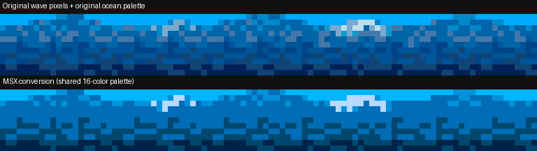
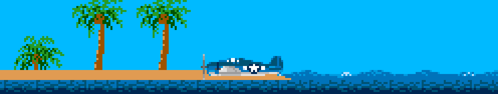

# Original ocean artwork

The earlier water mapping was incorrect: source 10 became bright foam and
source 19 was later changed to cyan. Both changes obscured the original blue
wave texture. The original assets include a separate `ocean.palette` image;
its CMAP gives source colors 3–12 the ocean blue ramp rather than the world
palette's fire, foliage and soil colors. This matches the supplied original
captures. Original files remain unchanged.

`assets_src/dashboard/waves.indices` retains all twelve unmodified 96×11
source wave frames in `wava`–`wavl` order, decoded with the verified shape masks.
`ocean-palette.rgb` retains the original 32-entry CMAP. `waves-ocean.png` previews
the frames using Amiga nibble-expanded display colors and transparent index 0.
The manifest records source palette and decoded pixel hashes and the complete
source-to-MSX mapping. Regenerate with `python tools/convert_dashboard.py`.

The mission palette reserves two blue slots for original ocean colors 10 and 8,
rounded to RGB3. Other palette slots retain their earlier values. The wave
conversion fits opaque pixels to five shared blue entries; source 19 remains
dark blue and only source zero is transparent. Aircraft pixels also use these
shared blue tones. The original gradient still has more shades than the MSX
conversion; this is an explicit color reduction, not a lossless color port.

The source wave geometry and animation frames are retained. All twelve have
transparent pixels only in their first two rows. Those rows use TIMP over the
scenery; the remaining nine use HMMM. Before the next phase, a per-page clean waterline
backup restores the original scenery, including the carrier hull's bottom row.
Backups now reserve four rows at Y=688 and 764 for carrier heave;
unscrolled views use two of those rows. They are invalidated when
changing view scale. This avoids cyan holes beneath the carrier and stale
crests while keeping the regular frame cadence unchanged.
See [carrier effects](ship-effects.md) for moving-hull compositing and the
wave-tail cache relocation required by hardware heave.

The shoreline capture also establishes water underneath the sand. The normal
beach shapes are six pixels tall with origin Y=1; their visible sand occupies
five rows starting at the baseline. Reduced beach art occupies one row. The
previous extension of the bottom sand row to the dashboard was incorrect and
has been removed. Waves now clip against the foreground sand on each scanline,
then continue across the full world for the six rows below the normal beach.
Odd-pixel silhouette edges use logical copies instead of rounding the sand.
Identical visible intervals merge vertically, preserving the two-row
transparency split, so open water retains two tall wave copies per source/ring
segment. Full visible pixels and frame deadlines remain checked in the emulator.

