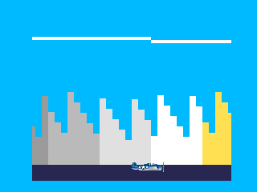

# World-space flight and following camera

Completed 2026-11-11. The `world-flight` prototype combines the recovered
aircraft poses with full-height synthetic terrain, bounded world-space motion,
and a following camera. It retains 30 Hz NTSC / 25 Hz PAL presentation.

```sh
./launch.sh world-flight
# Or build without opening the emulator:
./build.sh projname=world-flight
```

The ROM is `out/world-flight/world-flight.rom`. The default `./launch.sh` still
opens the earlier aircraft prototype; `./launch.sh hardware-scroll` opens the
independent 512-pixel ring benchmark.



## Controls and camera

Use cursor keys or joystick port 1. Acceleration, coasting, velocity-selected
pitch and banked reversals use the existing portable flight/animation logic.
**T**, while stationary, requests one review turn; holding it does not repeat.
**Space or joystick fire** resets altitude, velocity and pose while preserving
horizontal world position and camera location.

The world is 4,096 pixels wide. Unsigned 32-bit Q8 horizontal position preserves
fractional movement beyond the old 256-pixel coordinate range. Aircraft pivot
position is bounded to 0–4,095; altitude remains bounded to 0–180. Outward
velocity stops at a world boundary. Original drawing origins can put part or
all of a shape outside the viewport at the extreme world positions; rendering
clips it safely. There is no terrain collision yet.

The camera is `clamp(world_pixel - 128, 0, 3840)`. Thus it remains at the left
edge initially, follows the aircraft pivot at screen x=128 across the middle,
and stops at the right world edge. It moves back when the player reverses.
Simulation remains 150 Hz, grouped into five NTSC or six PAL steps per frame.
Camera coordinates, aircraft world position and VRAM address wrap are separate.

## Renderer choice

The earlier [hardware-scroll experiment](hardware-scrolling.md) measured a
512-pixel ring without aircraft. For composition, this prototype instead uses
two alternating **256-pixel single-page rings**. R#25's eight-pixel left mask
provides a visible 248×212 viewport and enough hidden space for eight-pixel
terrain columns. Keeping two such pages leaves the upper 64 KiB available for
the existing 49-shape aircraft atlas. Each pose uploads once at startup.

| VRAM allocation | Purpose |
| --- | --- |
| Page 0, rows 0–211 | First scrolling display page |
| Page 1, rows 0–211 | Second scrolling display page |
| Pages 0/1, x=0–43, rows 212–247 | Saved clean aircraft footprint, one per page |
| Pages 2/3, rows 0–179 | Existing immutable aircraft atlas |
| Remaining rows/regions | Unused by this prototype |

Before reusing a hidden page, the renderer restores its old aircraft footprint,
streams the incoming terrain columns, saves the new clean footprint, and draws
the new aircraft with transparent LMMM. Saved rectangles are byte-aligned;
aircraft drawing can start at odd pixels. Restoration, saving and drawing split
at the 256-pixel ring seam. Vertical and world-edge clipping preserve the
source drawing origins. The completed page and scroll registers publish during
VBlank. No writes to a displayed bitmap are needed.

The streamer tracks each page's previous camera independently. The visible
world interval is camera+8 through camera+255. Forward movement prepares new
columns based on its right edge; reverse movement uses its left edge. This
also handles one-pixel fine-scroll changes that expose a new right column
before crossing an eight-pixel camera boundary.

Synthetic terrain updates retain each cached column's height and distant
marker. They clear only newly exposed sky, paint the new terrain, and move
the marker when necessary. The ocean is initialized once. This avoids copying
full terrain columns and keeps the combined rendering budget within target.
It is an optimization specific to the authored scene, not a demonstrated
original-map decompression path.

Occupied ROM size is 29,331 bytes before 32 KiB padding, leaving 3,437 bytes.
Static RAM is 243 bytes plus the 452-byte IM2 reservation, stack and BIOS
workspace. The original aircraft source data and generated atlas are unchanged.

## Verification

| Emulated machine | Publications | Median interval | Maximum redraw | Misses | Snapshots | Hidden-page checks |
| --- | ---: | ---: | ---: | ---: | ---: | ---: |
| Panasonic_FS-A1WX-512K | 2,496 | 33.376 ms | 20.538 ms | 0 | 64 | 2,050 |
| C-BIOS_MSX2+_EU | 2,090 | 39.873 ms | 22.152 ms | 0 | 60 | 1,709 |

These are standard-speed openMSX timings for the tested trajectory, not a
worst-case gameplay budget. Redraw covers restoration, streaming, saving and
aircraft composition; publication cadence includes input and simulation too.

The checks compare every unmasked visible VRAM pixel and every completed raster
pixel to an independent world-plus-aircraft model. They cover both display
pages, all eight fine-scroll phases, successive aircraft ring crossings,
transparent terrain overlap, reverse flight, banked turns, top/world-edge
clipping, both world bounds and reset. Every redraw must target a hidden page;
the currently displayed 256×212 bitmap is compared before and after drawing.
Every cached aircraft rectangle is compared with its source at every snapshot.
Page and offset publication must occur inside VBlank with stable cadence.

As in the standalone benchmark, raster captures briefly hold simulation through
a dedicated diagnostic flag and wait for a completed raster. The emulator runs
unthrottled between captures and at real-time throttle during captures; the
emulated Z80/VDP speed is unchanged. The complete motion sequence uses keyboard
input. Physical joystick/hardware testing remains pending.

The 49 host tests pass, including three world-flight tests for coordinate/ring
crossings, both bounds, and identical PAL/NTSC simulation with bounded camera
steps. Generated aircraft verification, the normal ROM build and its NTSC
movement regression also pass. Retained reports identify the tested ROM:
[Panasonic](world-flight/panasonic.json) and [PAL](world-flight/pal.json).

```sh
python -m unittest discover -s tests -v
python tools/convert_hellcat.py --check
./build.sh projname=world-flight
python tools/verify_world_flight.py --output tools/.build/world-flight-final
python tools/verify_world_flight.py --machine C-BIOS_MSX2+_EU --output tools/.build/world-flight-final-pal
./build.sh
python tools/verify_flight.py
```

The next increment is to decode representative original world artwork and
establish a streamed terrain representation. This is now measured in the
separate [original-art tile prototype](tile-terrain.md), including a 16×16
tile dictionary and 64 KiB ASCII8 storage. Collision, original maps, combat, audio and
authentic flight dynamics remain separate work. ROM headroom is small enough
that mapper/storage selection should accompany original terrain integration.
